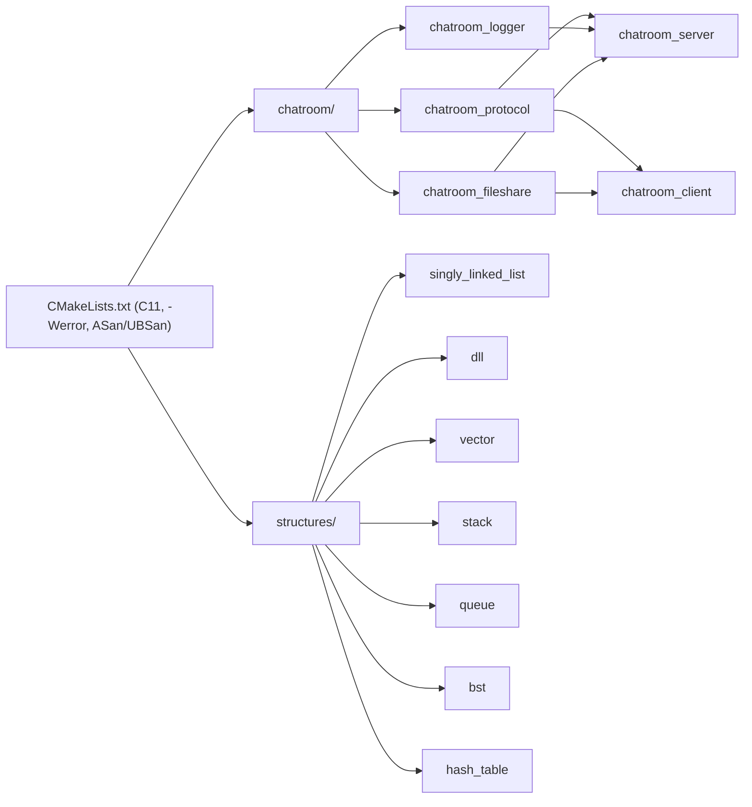

# C-projects

[](https://github.com/Dasperless/C-projects/actions/workflows/ci.yml)
[](LICENSE)

Systems programming and data-structure implementations in strict C11 (`-Wall -Wextra -Wpedantic -Wconversion -Wshadow -Werror`), tested with CTest under AddressSanitizer and UndefinedBehaviorSanitizer.

## Repository layout

```text
.
├── CMakeLists.txt
├── Makefile
├── chatroom/                       # Multi-threaded TCP chat server and client
│   ├── includes/                   # protocol.h, logger.h, fileshare.h
│   ├── server.c / client.c         # Server, admin console, client CLI
│   ├── protocol.c                  # Length-prefixed packet framing
│   ├── logger.c                    # Thread-safe ISO-8601 audit logger
│   ├── fileshare.c                 # Chunked binary file transfer + CRC32
│   └── tests/                      # Unit and multi-process integration tests
└── structures/                     # Standalone data structure libraries
    ├── linked-lists/
    │   ├── singly-linked-list/     # Node API + LinkedList container, MergeSort
    │   └── doubly-linked-list/     # O(1) ends, bidirectional traversal, splicing
    ├── vector/                     # Geometric-growth dynamic array
    ├── stack/                      # Dynamic LIFO stack
    ├── queue/                      # Circular ring-buffer FIFO queue
    ├── binary_search_tree/         # BST with traversals and 3-case deletion
    └── hash_table/                 # String-keyed DJB2 table with rehashing
```



## Prerequisites

- Linux or macOS
- CMake 3.20+
- GCC 9+ or Clang 10+
- POSIX threads (`pthread`)

## Quickstart

```bash
# Release build
cmake -B build -DCMAKE_BUILD_TYPE=Release
cmake --build build

# Debug build with sanitizers + full test run
cmake -B build -DCMAKE_BUILD_TYPE=Debug -DENABLE_ASAN=ON -DENABLE_UBSAN=ON
cmake --build build
ctest --test-dir build --output-on-failure
```

Or through the convenience `Makefile` wrapper (`make build`, `make asan`, `make test`, `make clean`).

### Running the chatroom

```bash
# Terminal 1: start the server (writes audit events to server.log by default)
./build/bin/chatroom_server 127.0.0.1 8888

# Terminal 2 & 3: connect clients
./build/bin/chatroom_client 127.0.0.1 8888
```

See [`chatroom/README.md`](chatroom/README.md) for the wire protocol, client commands (`/msg`, `/group`, `/users`, `/sendfile`), and server admin console (`users`, `stats`, `monitor`, `kick`, `broadcast`, `quit`), and [`structures/README.md`](structures/README.md) for the data structure APIs and complexity tables.

## Roadmap

- [x] Out-of-source CMake + Makefile build system and multi-compiler GitHub Actions CI
- [x] Singly and doubly linked lists (CRUD, in-place reverse, MergeSort)
- [x] Dynamic vector, stack, and circular-buffer queue
- [x] Binary search tree and dynamically rehashing hash table
- [x] Framed chatroom protocol with private messages, group channels, and `/users`
- [x] Append-only audit logger, chunked binary file transfer, and server admin console

## Contributing & License

Contributions are welcome — please read [`CONTRIBUTING.md`](CONTRIBUTING.md) first. Released under the [MIT License](LICENSE).
