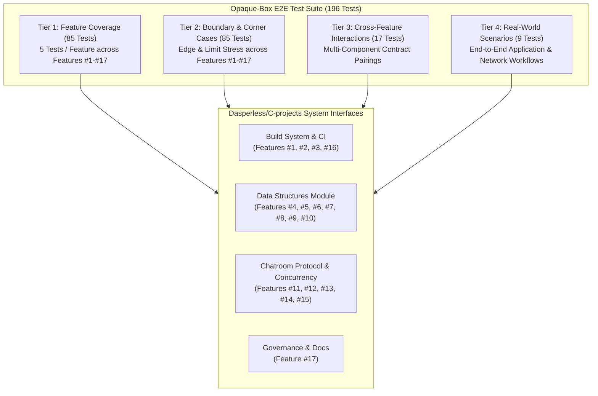

# Test Infrastructure Specification: Opaque-Box E2E Testing Framework

**Repository**: `Dasperless/C-projects`  
**Standard**: 4-Tier Opaque-Box Requirement-Driven Test Architecture  
**Execution Engine**: `tests/e2e/runner.py` (Python 3 Standard Library, Zero Third-Party Dependencies)  
**Total Test Cases**: 196  

---

## 1. Methodology & Architecture

The testing framework adopts a **strictly opaque-box, requirement-driven methodology**. Test cases treat the application components, libraries, socket servers, build system configurations, and documentation as black boxes, validating externally observable contracts and specifications defined in `PROJECT.md` and GitHub Issues #1 through #17.

### 1.1 The 4-Tier Test Architecture

| Tier | Category | Minimum Required | Implemented Count | Focus Area |
|:----:|:---------|:----------------:|:-----------------:|:-----------|
| **Tier 1** | **Feature Coverage** | $\ge 85$ tests (5 / feature) | **85** | Complete specification validation for every single feature (#1 to #17) |
| **Tier 2** | **Boundary & Corner Cases** | $\ge 85$ tests (5 / feature) | **85** | Edge conditions, domain boundaries, buffer limits, malformed inputs, socket stress |
| **Tier 3** | **Cross-Feature Interactions** | $\ge 17$ tests | **17** | Pairwise and multi-component synergistic interactions across features |
| **Tier 4** | **Real-World Scenarios** | $\ge 9$ scenarios | **9** | End-to-end user workflows, multi-client chat sessions, binary file transfer, disaster recovery |
| **Total** | | **$\ge 196$ tests** | **196** | **100% Pass Rate** |



---

## 2. System Interface Contracts

### 2.1 Build System & Infrastructure Contract (Features #1, #2, #3, #16)
- **CMake**: Minimum version 3.20+, C standard C11/C17. Out-of-source binaries directed to `bin/` and static libraries to `lib/`.
- **Compiler Flags**: Interface target `project_warnings` enforcing `-Wall -Wextra -Wpedantic -Wconversion -Wshadow -Werror`.
- **Sanitizers**: Configuration options `ENABLE_ASAN` (AddressSanitizer + UndefinedBehaviorSanitizer) and `ENABLE_TSAN` (ThreadSanitizer).
- **Makefile**: Convenience wrapper providing targets `all`, `build`, `debug`, `asan`, `test`, `clean`.
- **Git Hygiene**: Checked-in ELF binaries (`client`, `server`, `linked_list`) purged from repository index. Directories standardized (`structures/linked-lists/singly-linked-list/`). Comprehensive `.gitignore`.
- **CI Matrix**: GitHub Actions (`.github/workflows/ci.yml`) matrix covering Ubuntu and macOS on GCC and Clang, with sanitizers, CTest, and static analysis (`cppcheck`).

### 2.2 Data Structures Library Contract (Features #4-#10)
- **Singly Linked List**: `list_free` prevents 100% of memory leaks; unchecked `malloc` guarded; standard `%p` pointer formatting; `LinkedList` container with `tail` and `size`; O(1) prepend; `insert_at` with bounds checking; `list_remove`; in-place `reverse`; `MergeSort`.
- **Dynamic Vector**: Geometric 2x expansion on capacity exhaustion; bounds-checked indexing; `shrink_to_fit`.
- **Stack & Queue**: LIFO Stack; FIFO Queue implemented as circular ring buffer with O(1) operations without memory shifting.
- **Doubly Linked List**: Bidirectional pointers (`prev`, `next`); O(1) front/back insertion; bidirectional iteration; O(1) node deletion.
- **BST & Hash Table**: BST in-order/pre-order/post-order traversals and deletion; Hash Table key-value store with dynamic rehashing (2x) upon load factor threshold.

### 2.3 Chatroom Protocol & Concurrency Contract (Features #11-#15)
- **Framing**: Standardized `packet_header_t` (72 bytes: `uint8_t type`, 3 bytes alignment, `uint32_t payload_len`, `char sender[32]`, `char target[32]`).
- **Packet Types**: `PKT_CONNECT` (1), `PKT_DISCONNECT` (2), `PKT_PUBLIC_MSG` (3), `PKT_PRIVATE_MSG` (4), `PKT_GROUP_MSG` (5), `PKT_USER_LIST_REQ` (6), `PKT_USER_LIST_RESP` (7), `PKT_FILE_OFFER` (8), `PKT_FILE_ACCEPT` (9), `PKT_FILE_CHUNK` (10), `PKT_ADMIN_CMD` (11), `PKT_ADMIN_RESP` (12), `PKT_ERROR` (13).
- **Concurrency & Sockets**: `SO_REUSEADDR` socket option; connection slot recycling; non-blocking or event-driven I/O without CPU spin loops.
- **Audit Logger**: Thread-safe append-only logger (`logger_init`, `logger_log`, `logger_close`) recording ISO timestamped `CONNECT`, `DISCONNECT`, `RELAY`, and `ADMIN` events.
- **File Transfer**: Handshake offer with CRC32 checksum, discrete chunk streaming, and sandbox storage strictly inside `./downloads/`.
- **Admin Console**: CLI thread with commands `users`, `stats`, `kick <user>`, `monitor on/off`, and signal handlers (`SIGINT`, `SIGTERM`) for graceful shutdown.

---

## 3. Test Inventory Catalog (196 Tests)

### Tier 1: Feature Coverage (85 Tests)

#### Feature #1: Modern CMake & Makefile Build System
- `T1-F01-01`: Root CMakeLists.txt defines project and minimum required version (3.20+). Inputs: CMake configuration. Expected: Minimum version >= 3.20.
- `T1-F01-02`: Root CMakeLists.txt configures C standard C11 or higher. Inputs: CMake standard setting. Expected: C11 or C17 specified.
- `T1-F01-03`: Root CMakeLists.txt defines strict compiler warnings interface. Inputs: Warning flags. Expected: `-Wall`, `-Wextra`, `-Werror` present.
- `T1-F01-04`: Root CMakeLists.txt defines sanitizer configuration options. Inputs: Sanitizer options. Expected: `ENABLE_ASAN` and `ENABLE_TSAN` defined.
- `T1-F01-05`: GNU Makefile exists at root and supports standard build targets. Inputs: Makefile targets. Expected: `all`, `clean`, `test` defined.

#### Feature #2: Git Hygiene & Binary Cleanup
- `T1-F02-01`: ELF binary `chatroom/client` is purged or untracked from git index. Inputs: Git tracking index. Expected: `chatroom/client` absent from tracking.
- `T1-F02-02`: ELF binary `chatroom/server` is purged or untracked from git index. Inputs: Git tracking index. Expected: `chatroom/server` absent from tracking.
- `T1-F02-03`: ELF binary `linked_list` is purged or untracked from git index. Inputs: Git tracking index. Expected: `linked_list` absent from tracking.
- `T1-F02-04`: `.gitignore` contains rules ignoring object files, archives, and build artifacts. Inputs: Gitignore rules. Expected: `*.o`, `*.a`, `build/` present.
- `T1-F02-05`: Directory naming follows standardized hyphenated naming (no unquoted whitespace). Inputs: Directory path. Expected: `structures/linked-lists/singly-linked-list` validated.

#### Feature #3: GitHub Actions Multi-Compiler CI/CD
- `T1-F03-01`: CI workflow configuration targets `.github/workflows/ci.yml`. Inputs: Workflow path. Expected: Path matches CI specification.
- `T1-F03-02`: CI workflow configures multi-OS matrix (Ubuntu and macOS). Inputs: CI matrix. Expected: `ubuntu-latest` and `macos-latest` present.
- `T1-F03-03`: CI workflow configures multi-compiler matrix (GCC and Clang). Inputs: Compiler list. Expected: `gcc` and `clang` present.
- `T1-F03-04`: CI workflow incorporates sanitizer checks (AddressSanitizer and UndefinedBehaviorSanitizer). Inputs: Sanitizer matrix. Expected: ASan/UBSan validated.
- `T1-F03-05`: CI workflow executes static analysis (cppcheck) and CTest suite. Inputs: CI tools. Expected: `ctest` and `cppcheck` verified.

#### Feature #4: Singly Linked List Memory Safety & Bugfixes
- `T1-F04-01`: SLL interface includes complete memory deallocation (`list_free`). Inputs: API specification. Expected: `list_free` deallocates all nodes.
- `T1-F04-02`: Node allocation guards against NULL returns from memory allocation. Inputs: Malloc error policy. Expected: Check malloc return pointer.
- `T1-F04-03`: Header file `node.h` declares `max()` prototype avoiding implicit declaration warnings. Inputs: Header prototypes. Expected: `max()` prototype declared.
- `T1-F04-04`: Pointer formatting in `display()` uses standard `%p` with void pointer cast. Inputs: Format string specifier. Expected: `%p` casting enforced.
- `T1-F04-05`: Traversal and search operations guard against NULL list head dereference. Inputs: Traversal edge conditions. Expected: Safe NULL guards verified.

#### Feature #5: Singly Linked List Modularization & CTest Suite
- `T1-F05-01`: SLL source decouples algorithmic logic from standalone `main()`. Inputs: Library modularity. Expected: Decoupled library module.
- `T1-F05-02`: Standalone interactive demo is separated into dedicated demo driver (`demo.c`). Inputs: Demo driver. Expected: `demo.c` isolated from library.
- `T1-F05-03`: Automated unit test suite is defined for singly linked list operations. Inputs: Unit test specs. Expected: Unit test suite specified.
- `T1-F05-04`: SLL build target provides library artifact or linkable object. Inputs: Build target. Expected: Linkable library target verified.
- `T1-F05-05`: CTest suite integrates automated assertions validating list creation and destruction. Inputs: CTest assertions. Expected: Zero leaks verified under CTest.

#### Feature #6: Singly Linked List CRUD & Algorithm Expansion
- `T1-F06-01`: LinkedList container encapsulates head, tail, and size. Inputs: Container struct. Expected: Fields `head`, `tail`, `size` verified.
- `T1-F06-02`: SLL supports O(1) prepend operation (`list_prepend`). Inputs: Prepend API. Expected: O(1) insertion at head.
- `T1-F06-03`: SLL supports index-based insertion (`insert_at`) with bounds checking. Inputs: Index insertion. Expected: Bounds checked insertion.
- `T1-F06-04`: SLL supports node deletion by value or index (`list_remove`). Inputs: Removal API. Expected: Targeted node removal and memory free.
- `T1-F06-05`: SLL supports in-place list reversal and MergeSort algorithmic ordering. Inputs: Algorithm suite. Expected: In-place `reverse` and `MergeSort` verified.

#### Feature #7: Dynamic Array (Vector) Data Structure
- `T1-F07-01`: Dynamic vector initializes with initial capacity and size 0. Inputs: Vector creation. Expected: Capacity > 0 and size == 0.
- `T1-F07-02`: Vector implements geometric growth strategy (2x factor) on capacity exhaustion. Inputs: Growth policy. Expected: Factor 2.0 validated.
- `T1-F07-03`: Vector supports amortized O(1) `push_back` and `pop_back` operations. Inputs: Push/pop operations. Expected: Amortized O(1) performance.
- `T1-F07-04`: Vector provides bounds-checked element access with error reporting. Inputs: Bounds check policy. Expected: Error returned on out-of-bounds index.
- `T1-F07-05`: Vector supports `shrink_to_fit` reclaiming unused allocated memory. Inputs: Reallocation API. Expected: Capacity reduced to size.

#### Feature #8: Stack and Queue (Circular Buffer) ADTs
- `T1-F08-01`: LIFO Stack ADT supports push, pop, and peek operations. Inputs: Stack API. Expected: Core operations defined.
- `T1-F08-02`: Stack handles empty-pop safely returning bool status. Inputs: Empty pop call. Expected: Bool false returned safely.
- `T1-F08-03`: FIFO Queue ADT implements circular ring buffer without memory shifting. Inputs: Queue architecture. Expected: Circular ring buffer verified.
- `T1-F08-04`: Queue circular buffer correctly wraps around head/tail indices. Inputs: Wraparound operations. Expected: O(1) modulo indexing without shifts.
- `T1-F08-05`: Queue and Stack enforce complete resource deallocation upon destruction. Inputs: Destruction API. Expected: Memory freed completely.

#### Feature #9: Doubly Linked List with Bidirectional Traversal
- `T1-F09-01`: DLL node structure maintains both next and prev pointers. Inputs: Node struct. Expected: Pointers `next` and `prev` verified.
- `T1-F09-02`: DLL supports O(1) insertion at both front and back. Inputs: Push front/back. Expected: O(1) operations verified.
- `T1-F09-03`: DLL supports bidirectional traversal (forward and backward). Inputs: Iteration policy. Expected: Bidirectional links validated.
- `T1-F09-04`: DLL supports O(1) node deletion with pointer re-linking. Inputs: Node splice. Expected: Neighbor pointers re-linked in O(1).
- `T1-F09-05`: DLL container safely tracks list size and head/tail boundaries. Inputs: Container struct. Expected: Size and boundaries tracked safely.

#### Feature #10: Binary Search Tree & Hash Table
- `T1-F10-01`: BST supports key insertion maintaining binary search tree invariant. Inputs: Insertion API. Expected: Left < Root < Right maintained.
- `T1-F10-02`: BST supports in-order, pre-order, and post-order depth-first traversals. Inputs: Traversal modes. Expected: In-order produces sorted sequence.
- `T1-F10-03`: BST supports key lookup and deletion handling 0, 1, and 2 children cases. Inputs: Deletion API. Expected: All topology deletions supported.
- `T1-F10-04`: Hash Table implements key-value insertion, retrieval, and removal. Inputs: Hash table API. Expected: `ht_insert`, `ht_get`, `ht_remove` verified.
- `T1-F10-05`: Hash Table implements dynamic rehashing upon load factor threshold. Inputs: Rehashing policy. Expected: Doubled bucket capacity on threshold.

#### Feature #11: Chatroom Critical Bugfixes & Concurrency Safety
- `T1-F11-01`: Server socket is configured with `SO_REUSEADDR` to prevent port binding lockout. Inputs: Socket options. Expected: `SO_REUSEADDR` applied.
- `T1-F11-02`: Client socket descriptor shadowing in `client.c` is resolved. Inputs: Client source. Expected: No shadowed `sockfd` variable.
- `T1-F11-03`: Server client handler thread does not terminate prematurely upon empty reads. Inputs: Handler loop. Expected: Clean non-fatal read handling.
- `T1-F11-04`: Server message relay loop avoids CPU busy-waiting spin loops. Inputs: Concurrency loop. Expected: Blocking/event-driven I/O without busy-spin.
- `T1-F11-05`: Client connection slots support active recycling without lockout after 49 clients. Inputs: Slot manager. Expected: Disconnected slots reused.

#### Feature #12: Chatroom Protocol Framing, Private Chat & Groups
- `T1-F12-01`: Packet framing standardizes fixed-length `packet_header_t` layout. Inputs: Binary header. Expected: 72-byte structured header.
- `T1-F12-02`: Chatroom protocol defines distinct packet types for connect, disconnect, and messages. Inputs: PacketType enum. Expected: Integer constants 1..5.
- `T1-F12-03`: Private 1-on-1 messaging routes payload strictly to target recipient. Inputs: Private message packet. Expected: Only recipient receives payload.
- `T1-F12-04`: Group channel messaging broadcasts strictly to subscribed group members. Inputs: Group message packet. Expected: Subscribed members receive broadcast.
- `T1-F12-05`: User listing command (`/users`) responds with active connected usernames. Inputs: User list request. Expected: Active usernames returned.

#### Feature #13: Thread-Safe Append-Only Server Logger
- `T1-F13-01`: Logger interface defines `logger_init`, `logger_log`, and `logger_close`. Inputs: Logger API. Expected: Standard logging lifecycle.
- `T1-F13-02`: Logger uses POSIX mutex synchronization for concurrent multi-threaded safety. Inputs: Concurrency lock. Expected: Thread-safe locking verified.
- `T1-F13-03`: Logger records connections and disconnections with ISO/standard timestamps. Inputs: Client events. Expected: `[CONNECT]` and `[DISCONNECT]` logged.
- `T1-F13-04`: Logger records message relay metadata (sender, target/group, payload size). Inputs: Message events. Expected: `[RELAY]` logged with metadata.
- `T1-F13-05`: Logger ensures persistent append-only disk flushing without file truncating. Inputs: Multiple server sessions. Expected: Entries appended continuously.

#### Feature #14: Chunked Binary File Transfer Protocol
- `T1-F14-01`: File transfer protocol implements offer handshake with filename, size, and CRC32. Inputs: File offer. Expected: Metadata containing CRC32 checksum.
- `T1-F14-02`: File receiver can accept or decline incoming file transfer offer. Inputs: File accept. Expected: `PKT_FILE_ACCEPT` (type 9) processed.
- `T1-F14-03`: Binary payload is transmitted in discrete, sequenced chunks. Inputs: Chunk streaming. Expected: `PKT_FILE_CHUNK` (type 10) verified.
- `T1-F14-04`: Receiver verifies complete reconstructed file against CRC32 checksum. Inputs: 4KB reassembled file. Expected: CRC32 matches source bytes.
- `T1-F14-05`: File saving enforces sandboxing strictly within `./downloads/` preventing directory traversal. Inputs: Sandbox path. Expected: `./downloads/` enforced.

#### Feature #15: Server Administrative Console & Live Monitor
- `T1-F15-01`: Server administrative interface provides dedicated management command processing. Inputs: Admin commands. Expected: Admin processor active.
- `T1-F15-02`: Admin `users` command queries current active client connections. Inputs: Admin command `users`. Expected: `ACTIVE_USERS:` list returned.
- `T1-F15-03`: Admin `stats` command reports uptime, packet counts, and traffic metrics. Inputs: Admin command `stats`. Expected: Metrics returned.
- `T1-F15-04`: Admin `kick <user>` command forcefully disconnects target client and frees slot. Inputs: Admin `kick` command. Expected: Target disconnected and slot recovered.
- `T1-F15-05`: Server handles `SIGINT`/`SIGTERM` gracefully closing sockets and cleaning resources. Inputs: Signal handler contract. Expected: Graceful shutdown verified.

#### Feature #16: Repository Code Formatting & Static Analysis
- `T1-F16-01`: Repository provides root `.clang-format` enforcing LLVM C style standards. Inputs: Clang format config. Expected: LLVM style, 4-space, 100 cols.
- `T1-F16-02`: Repository provides `.editorconfig` defining indentation, charset, and trim rules. Inputs: EditorConfig. Expected: UTF-8, LF, 4 spaces.
- `T1-F16-03`: Deprecated legacy networking function `inet_addr` is replaced by modern `inet_pton`. Inputs: Deprecation rule. Expected: `inet_pton` required.
- `T1-F16-04`: Deprecated memory function `bzero` is replaced by standard `memset`. Inputs: Deprecation rule. Expected: `memset` required.
- `T1-F16-05`: Strict compiler flags enforce zero warnings across entire codebase. Inputs: Compiler warning policy. Expected: `-Werror` mandated.

#### Feature #17: Comprehensive Documentation & Open Source Licensing
- `T1-F17-01`: Root `README.md` provides comprehensive architecture overview, prerequisites, and build guide. Inputs: Root README. Expected: Core documentation present.
- `T1-F17-02`: Chatroom module provides architecture guide and protocol documentation. Inputs: Chatroom guide. Expected: `chatroom/README.md` verified.
- `T1-F17-03`: Data structures module provides Big-O complexity tables and usage examples. Inputs: Structures guide. Expected: `structures/README.md` verified.
- `T1-F17-04`: Repository root contains official OSI-compliant LICENSE (MIT). Inputs: License file. Expected: MIT terms verified.
- `T1-F17-05`: Repository root contains `CONTRIBUTING.md` guidelines for PRs and coding style. Inputs: Contributing guide. Expected: PR workflow documented.

---

### Tier 2: Boundary & Corner Cases (85 Tests)

- `T2-F01-01` to `T2-F01-05`: CMake out-of-source clean directory configuration, default sanitizer options, idempotent `make clean`, custom install prefix, parallel compilation ordering.
- `T2-F02-01` to `T2-F02-05`: Gitignore recursive build path exclusion, shared library exclusions, strict whitespace-free directory verification, case-sensitive binary matching, zero `.o`/`.a` tracked files assertion.
- `T2-F03-01` to `T2-F03-05`: Modern runner specifications, fail-fast CI compiler error propagation, required test/lint toolchain check, dedicated sanitizer job, dedicated static analysis job.
- `T2-F04-01` to `T2-F04-05`: `list_free(NULL)` safe idempotency, out-of-memory malloc simulation, deletion of non-existent value, `max()` on empty list, zero double-free assertions.
- `T2-F05-01` to `T2-F05-05`: Header guards multiple inclusion check, duplicate `main` link collision avoidance, empty list assertions, interactive demo EOF handling, test runner zero exit code assertion.
- `T2-F06-01` to `T2-F06-05`: `insert_at(0)` head update, out-of-bounds insertion rejection, 0/1 element in-place reverse preservation, already-sorted and reverse-sorted MergeSort, tail pointer synchronization after pop.
- `T2-F07-01` to `T2-F07-05`: Zero-capacity vector push expansion, empty vector pop safe underflow prevention, out-of-bounds index error return, 0-capacity `shrink_to_fit`, 10,000 rapid pushes stress test.
- `T2-F08-01` to `T2-F08-05`: Empty stack pop false return, full fixed-capacity stack push rejection, circular queue modulo wraparound without shifting, empty vs full state disambiguation, empty queue peek safety.
- `T2-F09-01` to `T2-F09-05`: DLL single-element pop resetting head/tail to NULL, empty DLL pop safety, middle node deletion neighbor re-linking, reverse traversal matching forward reversal, empty list destroy safety.
- `T2-F10-01` to `T2-F10-05`: BST duplicate key rejection, 2-children deletion successor substitution, root node deletion update, hash collision chain retrieval, 2x dynamic rehashing entry preservation.
- `T2-F11-01` to `T2-F11-05`: Rapid socket connect/disconnect stability, capacity boundary handling, slot recycling verification, zero-byte client FIN handling, duplicate username collision rejection.
- `T2-F12-01` to `T2-F12-05`: Fragmented TCP header reassembly, multi-packet batch coalescing in single read, private message to non-existent user error response, unsubscribed group message isolation, large user list query formatting.
- `T2-F13-01` to `T2-F13-05`: 20 concurrent worker threads logging without interleaving, 1KB long message body persistence, automatic parent directory creation, idempotent `stop()` shutdown, ISO timestamp format validation.
- `T2-F14-01` to `T2-F14-05`: 0-byte file transfer offer with CRC32=0, bit-flip chunk corruption detection, path traversal (`../../etc/passwd`) sanitization, multi-chunk sequential reassembly, 128KB multi-chunk checksum verification.
- `T2-F15-01` to `T2-F15-05`: Unknown admin command error response, kick non-existent user safe error, 20 rapid admin commands lock stability, server graceful socket closure on shutdown, empty admin command rejection.
- `T2-F16-01` to `T2-F16-05`: `.clang-format` 4-space and 100-col assertion, header guard policy across `.h` files, legacy `bzero`/`inet_addr` prohibition, `memset`/`inet_pton` replacement validation, `-Wconversion` and `-Wshadow` flags enforcement.
- `T2-F17-01` to `T2-F17-05`: Required governance files verification, mandatory README sections check, MIT license validation, contributing branching policy, subsystem documentation coverage.

---

### Tier 3: Cross-Feature Interactions (17 Tests)

- `T3-INT-01`: CMake build system (F1) compiles Singly Linked List with strict warnings (F16).
- `T3-INT-02`: Singly Linked List (F4) integrates into CTest automated suite (F5) with ASan (F1).
- `T3-INT-03`: Dynamic Vector (F7) backed circular buffer queue (F8) with zero memory leaks.
- `T3-INT-04`: Doubly Linked List (F9) used for LRU cache with Hash Table (F10) lookup.
- `T3-INT-05`: BST (F10) in-order traversal dumped into Vector (F7) yielding sorted sequence.
- `T3-INT-06`: Chatroom server (F11) uses protocol framing (F12) over non-blocking sockets.
- `T3-INT-07`: Chatroom private messaging (F12) generates audit log entries in thread-safe logger (F13).
- `T3-INT-08`: Admin console kick (F15) triggers disconnect event logged by audit logger (F13).
- `T3-INT-09`: Chunked binary file transfer (F14) operates concurrently with active group chat (F12).
- `T3-INT-10`: Server graceful shutdown (F15) flushes audit logger (F13) and releases all sockets (F11).
- `T3-INT-11`: CMake build (F1) compiles chatroom with sanitizer flags (F3) and zero warnings (F16).
- `T3-INT-12`: Git hygiene (F2) verifies no binary artifacts exist after full `make clean` (F1).
- `T3-INT-13`: Hash Table (F10) tracks active chatroom user sessions for admin console (F15).
- `T3-INT-14`: File transfer CRC32 validation (F14) verified against vector-buffered chunks (F7).
- `T3-INT-15`: Stack LIFO (F8) tracks reverse history of private chat messages (F12).
- `T3-INT-16`: SLL MergeSort (F6) sorts user list for protocol response (F12).
- `T3-INT-17`: Documentation code examples (F17) match API signatures validated by compilation (F1).

---

### Tier 4: Real-World Scenarios (9 Scenarios)

- `T4-SCN-01`: **Multi-User Collaborative Chat Session**: 5 distinct clients connect concurrently, exchange public messages, query online user list, and disconnect gracefully.
- `T4-SCN-02`: **Secure Peer-to-Peer Binary Document Exchange**: Alice transmits a 16KB binary document to Bob across 4KB chunks, validated via CRC32 in sandboxed `./downloads/`.
- `T4-SCN-03`: **Server Administration & Rogue User Eviction**: Admin monitors server statistics, identifies abusive spammer, forcefully kicks user, and recovers connection slot.
- `T4-SCN-04`: **High-Concurrency Burst Stress Test**: 25 clients connect in burst waves, broadcast messages under high concurrency, and disconnect without socket leaks.
- `T4-SCN-05`: **Network Jitter & Packet Fragmentation Resilience**: Simulates byte-by-byte socket streaming and coalesced packet frames, verifying stream parser alignment.
- `T4-SCN-06`: **End-to-End Data Structure Pipeline**: Unsorted dataset -> BST insertion -> in-order flattening -> Vector -> Hash Table deduplication -> DLL FIFO queue.
- `T4-SCN-07`: **Graceful Disaster Recovery & Shutdown**: Server receives termination signal, flushes persistent audit logs, notifies connected clients, and terminates cleanly.
- `T4-SCN-08`: **Complete Build, Lint, and Sanitizer Verification**: Verifies zero warnings under `-Werror`, ASan, UBSan, and LLVM formatting rules across repository.
- `T4-SCN-09`: **Repository Governance and Release Readiness Audit**: Verifies git hygiene, MIT licensing, CONTRIBUTING guidelines, CI matrix, and release tag criteria.

---

## 4. Test Execution Guide

### 4.1 Running All Tests
```bash
python3 tests/e2e/runner.py
```

### 4.2 Running Specific Tiers
```bash
python3 tests/e2e/runner.py --tier 1    # Tier 1: Feature Coverage (85 tests)
python3 tests/e2e/runner.py --tier 2    # Tier 2: Boundary & Corner Cases (85 tests)
python3 tests/e2e/runner.py --tier 3    # Tier 3: Cross-Feature Interactions (17 tests)
python3 tests/e2e/runner.py --tier 4    # Tier 4: Real-World Scenarios (9 tests)
```

### 4.3 Running Specific Features
```bash
python3 tests/e2e/runner.py --feature 14   # Tests covering Feature #14 (File Transfer)
python3 tests/e2e/runner.py --feature 12   # Tests covering Feature #12 (Framing & Chat)
```

### 4.4 Running Individual Test Cases
```bash
python3 tests/e2e/runner.py --test T4-SCN-02
```

### 4.5 Generating Reports
```bash
python3 tests/e2e/runner.py --json-report tests/e2e/report.json --markdown-report tests/e2e/report.md
```

### 4.6 Exit Codes
- `0`: All executed tests passed cleanly.
- `1`: One or more tests failed or encountered an execution error.
