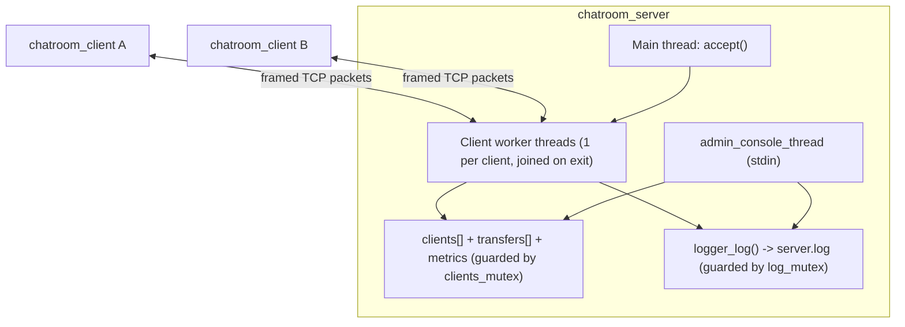

# Chatroom

A multi-threaded TCP chat server and client in C11 with length-prefixed framing, private and group messaging, chunked binary file transfer, a persistent audit logger, and an interactive server console.

## Architecture



### Wire protocol (`includes/protocol.h`, `protocol.c`)

Every message on the wire is a 68-byte packed header (network byte order) followed by `payload_len` bytes (`0..4160`):

```c
typedef struct __attribute__((packed)) {
    uint16_t type;                        /* packet_type_t */
    uint16_t payload_len;                 /* 0 .. PROTO_MAX_PAYLOAD (4160) */
    char sender[32];                      /* stamped by the server from the handshake */
    char recipient_or_group[32];          /* target user or #group */
} packet_header_t;
```

`send_all()` and `recv_all()` loop across short reads/writes and `EINTR` so TCP segment fragmentation or coalescing never tears a frame. Each outbound frame is assembled in a stack buffer and written in one `send_all()` under `clients_mutex` (server) or `send_mu` (client), preventing interleaved bytes when multiple threads write to the same socket.

| Type | Value | Direction | Purpose |
|---|---:|---|---|
| `PKT_HANDSHAKE` | 1 | C -> S | Register username (`[A-Za-z0-9_.-]{2,30}`, unique) |
| `PKT_MSG_PUBLIC` | 2 | C <-> S | Broadcast to all other connected users |
| `PKT_MSG_PRIVATE` | 3 | C <-> S | 1-on-1 message to `recipient_or_group` |
| `PKT_MSG_GROUP` | 4 | C <-> S | Channel message to members of `#<group>` |
| `PKT_CMD_USERS` | 5 | C -> S | Request the list of connected users |
| `PKT_CMD_JOIN_GRP` / `LEAVE_GRP` | 6 / 7 | C -> S | Join or leave a group channel |
| `PKT_DISCONNECT` | 8 | C -> S | Clean departure |
| `PKT_SERVER_INFO` / `ERROR` | 9 / 10 | S -> C | Server notices and errors |
| `PKT_FILE_OFFER` .. `PKT_FILE_ABORT` | 11..15 | C <-> S | Chunked binary file transfer |

### File transfer (`includes/fileshare.h`, `fileshare.c`)

1. `/sendfile <user> <path>` computes the file size (max 50 MB) and IEEE CRC-32, sanitizes the basename (`../../etc/passwd` -> `passwd`), and sends a 144-byte `file_offer_t`.
2. The server validates the offer, assigns a `transfer_id`, forwards the offer to the recipient, and echoes it to the sender.
3. The recipient types `y`/`n` (or `/fileaccept <id>` / `/filereject <id>`). Accepting atomically reserves `./downloads/<name>.part` (`O_CREAT | O_EXCL`, picking `<name>.1`, `<name>.2`, ... if the destination already exists).
4. A detached sender thread streams 4096-byte chunks (`PKT_FILE_CHUNK`). Both ends render a `[=====>    ] 50%` progress bar.
5. On the last chunk the receiver verifies the running CRC-32 against the offer and renames `.part` into place; any mismatch or disconnect deletes the partial file and sends `PKT_FILE_ABORT`.

### Audit logger (`includes/logger.h`, `logger.c`)

`logger_init(path)` opens the log file with `"a"`. `logger_log()` formats an ISO-8601 UTC timestamp, escapes control characters (`\n` -> `\n`) so user input cannot forge extra log entries, writes the line under `log_mutex`, and flushes immediately:

```text
[2026-11-11T14:20:05Z] [INFO] [CONN] Client 'alice' connected from 127.0.0.1:54321
[2026-11-11T14:20:07Z] [INFO] [PRIV] 'alice' -> 'bob': "Secret meeting"
```

### Administrative console (`server.c`)

| Command | Effect |
|---|---|
| `help` | List console commands |
| `users` | Table of active clients (UID, username, IP, port, connected duration) |
| `stats` | Uptime, active/peak clients, lifetime connections, message & byte counters |
| `monitor [on\|off]` | Show or toggle live traffic echoing on server stdout |
| `kick <username>` | Send an error notice to the user, close their socket, notify the room |
| `broadcast <msg>` | Send `[ADMIN] <msg>` to every connected client |
| `shutdown` / `quit` (or `SIGINT`/`SIGTERM`) | Broadcast `SERVER_SHUTDOWN`, close client sockets, join worker threads, flush the log, exit 0 |

## Building and testing

```bash
cmake -B build -DENABLE_ASAN=ON -DENABLE_UBSAN=ON && cmake --build build
ctest --test-dir build --output-on-failure -R "logger|fileshare|protocol|chat|file_transfer|admin|concurrency"
```
