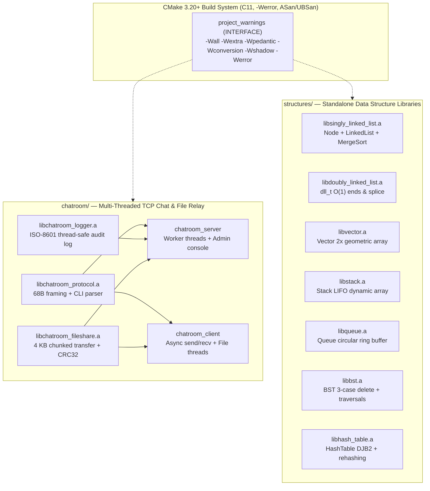

# C-projects Documentation

Welcome to the comprehensive technical documentation for **`C-projects`** — a collection of systems programming modules and foundational data structures written in strict C11 (`-std=c11`, `-Werror`) with C++ interoperability, multi-threaded POSIX networking, and continuous verification under AddressSanitizer (`ASan`) and UndefinedBehaviorSanitizer (`UBSan`).

---

## Documentation Structure (Diátaxis Framework)

This documentation is organized around four distinct developer needs:

| Guide | Category | Description |
|---|---|---|
| **[Getting Started](getting-started.md)** | *Tutorial & How-To* | Prerequisites, CMake and `Makefile` build workflows, running the chatroom server/client, and integrating static libraries into C or C++ applications. |
| **[Architecture & Design](architecture.md)** | *Explanation* | System topology, strict module boundaries, memory ownership contracts, thread synchronization, and cross-platform POSIX portability (Linux & macOS). |
| **[Chatroom System & Wire Protocol](chatroom-protocol.md)** | *Reference & Explanation* | 68-byte length-prefixed packet framing, client/server concurrency model, chunked 4 KB binary file transfer with IEEE CRC-32, ISO-8601 audit logging, and interactive admin console. |
| **[Data Structures API Reference](data-structures.md)** | *API Reference* | Doxygen-style C/C++ API reference, memory layouts, invariants, and asymptotic time/space complexity for all seven data structure libraries. |
| **[Testing, Sanitizers & Quality Gates](testing-and-quality.md)** | *How-To & Reference* | CTest unit and multi-process integration test harness, `ASan`/`UBSan`/`TSan` configurations, `clang-format` rules, `cppcheck` static analysis, and CI pipeline matrix. |

---

## System Overview

---

## Core Engineering Principles

1. **Strict Standard Compliance**: All targets compile under `-std=c11` with `CMAKE_C_EXTENSIONS OFF` and `-Wall -Wextra -Wpedantic -Wconversion -Wshadow -Werror`.
2. **Deterministic Memory Ownership**: Every allocation has an explicit constructor/destructor pair (`*_create` / `*_destroy`, `*_open` / `*_close`) verified leak-free and out-of-bounds-free under AddressSanitizer.
3. **Zero Cross-Contamination**: Every library in `structures/` is self-contained with zero dependencies on `chatroom/` or external third-party packages.
4. **C and C++ Interoperability**: Public headers use clean include guards, explicit pointer contexts, fixed-width integers (`<stdint.h>`), and `extern "C"` linkage blocks where applicable so C++17/C++20 consumers can link directly against the compiled static archives.
5. **Bounded Wire & Buffer Operations**: Network packets and file transfers validate all sizes against compile-time upper bounds (`PROTO_MAX_PAYLOAD = 4160`, `FS_MAX_FILE_SIZE = 50 MB`) before copying or allocating.

---

## Quick Links

- [Root README](../README.md)
- [Chatroom Module Overview](../chatroom/README.md)
- [Data Structures Overview](../structures/README.md)
- [Contributing Guidelines](../CONTRIBUTING.md)
