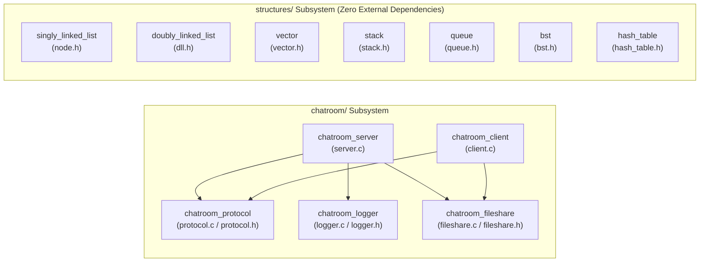
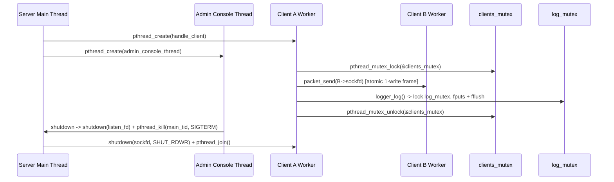

# Architecture & Design Principles

This document explains the architectural boundaries, memory management model, concurrency invariants, and cross-platform portability patterns used across `NetStruct`.

---

## 1. High-Level Module Topology

`NetStruct` is partitioned into two top-level subsystems with **zero cross-dependencies**:

1. **`chatroom/`**: A multi-threaded POSIX TCP client/server system composed of three reusable static libraries (`chatroom_protocol`, `chatroom_logger`, `chatroom_fileshare`) and two executables (`chatroom_server`, `chatroom_client`).
2. **`structures/`**: Seven standalone, single-responsibility static libraries implementing fundamental data structures (`singly_linked_list`, `doubly_linked_list`, `vector`, `stack`, `queue`, `bst`, `hash_table`).

### Module Responsibility Matrix

| Target | Type | Header(s) | Source(s) | Core Responsibility |
|---|---|---|---|---|
| `chatroom_protocol` | Static Lib | [`protocol.h`](../chatroom/includes/protocol.h) | [`protocol.c`](../chatroom/protocol.c) | 68-byte network framing, `send_all`/`recv_all`, username validation, CLI parser |
| `chatroom_logger` | Static Lib | [`logger.h`](../chatroom/includes/logger.h) | [`logger.c`](../chatroom/logger.c) | Mutex-serialized append-only ISO-8601 UTC logger with log-injection escaping |
| `chatroom_fileshare` | Static Lib | [`fileshare.h`](../chatroom/includes/fileshare.h) | [`fileshare.c`](../chatroom/fileshare.c) | IEEE CRC-32, path sanitization, 4 KB chunk codec, `.part` atomic file receiver |
| `chatroom_server` | Executable | — | [`server.c`](../chatroom/server.c) | TCP listener, worker thread pool, group routing, file relay, admin console |
| `chatroom_client` | Executable | — | [`client.c`](../chatroom/client.c) | Interactive terminal client, async receive loop, detached file-sender threads |
| `singly_linked_list` | Static Lib | [`node.h`](../structures/linked-lists/singly-linked-list/node.h) | [`linked_list.c`](../structures/linked-lists/singly-linked-list/linked_list.c), [`list_container.c`](../structures/linked-lists/singly-linked-list/list_container.c) | Intrusive `Node` helpers and `LinkedList` container with $O(N \log N)$ MergeSort |
| `doubly_linked_list` | Static Lib | [`dll.h`](../structures/linked-lists/doubly-linked-list/dll.h) | [`dll.c`](../structures/linked-lists/doubly-linked-list/dll.c) | Bidirectional `dll_t` list with $O(1)$ ends and arbitrary node splicing |
| `vector` | Static Lib | [`vector.h`](../structures/vector/vector.h) | [`vector.c`](../structures/vector/vector.c) | Contiguous dynamic array (`Vector`) with $2\times$ geometric growth |
| `stack` | Static Lib | [`stack.h`](../structures/stack/stack.h) | [`stack.c`](../structures/stack/stack.c) | Dynamic array LIFO `Stack` |
| `queue` | Static Lib | [`queue.h`](../structures/queue/queue.h) | [`queue.c`](../structures/queue/queue.c) | Circular ring-buffer FIFO `Queue` with wrap-around indexing |
| `bst` | Static Lib | [`bst.h`](../structures/binary_search_tree/bst.h) | [`bst.c`](../structures/binary_search_tree/bst.c) | Binary search tree (`BST`) with 3-case deletion and recursive traversals |
| `hash_table` | Static Lib | [`hash_table.h`](../structures/hash_table/hash_table.h) | [`hash_table.c`](../structures/hash_table/hash_table.c) | String-keyed separate-chaining `HashTable` (DJB2 hash, auto-rehash at $\alpha \ge 0.75$) |

---

## 2. Memory Ownership & Lifetime Model

Every module in `NetStruct` follows deterministic, RAII-inspired C11 resource management conventions:

### Constructor / Destructor Symmetry

| Resource Type | Constructor | Destructor | Ownership Semantics |
|---|---|---|---|
| `LinkedList` | `list_create()` | `list_destroy(list)` | Owns all internal `Node` allocations; `list_clear()` frees nodes without freeing the container. |
| Raw `node *` | `list_append_node(&head, v)` | `list_free(&head)` | Caller owns head pointer; `list_free` frees chain and sets `*head = NULL`. |
| `dll_t` | `dll_create()` | `dll_destroy(list)` | Owns all `dll_node_t` nodes; safe to pass `NULL` to `dll_destroy`. |
| `Vector` | `vector_create(cap)` | `vector_destroy(vec)` | Owns contiguous `int *data` buffer; `initial_capacity == 0` performs lazy allocation on first push. |
| `Stack` | `stack_create(cap)` | `stack_destroy(stack)` | Owns `int *data` buffer (defaults to capacity 4 when `cap == 0`). |
| `Queue` | `queue_create(cap)` | `queue_destroy(queue)` | Owns circular `int *data` buffer; unrolls elements into linear order on $2\times$ capacity expansion. |
| `BST` | `bst_create()` | `bst_destroy(tree)` | Owns all `BSTNode` allocations; post-order traversal deallocation in `free_subtree()`. |
| `HashTable` | `ht_create(buckets)` | `ht_destroy(ht)` | Deep-copies string keys (`malloc` + `memcpy`); caller retains ownership of input `const char *key`. |
| `fs_sender_t` | `fs_sender_open(...)` | `fs_sender_close(s)` | Caller allocates `fs_sender_t` struct (stack or static); module manages internal `FILE *fp`. |
| `fs_receiver_t` | `fs_receiver_open(...)` | `fs_receiver_chunk` / `fs_receiver_abort` | Reserves `<name>.part` via `O_CREAT \| O_EXCL`; closes and renames on completion or `unlink`s on abort. |

### Defensive Allocation & Overflow Guards

1. **Integer Overflow Prevention**: Dynamic buffers (`Vector`, `Stack`, `Queue`) verify `new_cap <= SIZE_MAX / 2` and `new_cap <= SIZE_MAX / sizeof(int)` before calling `malloc` or `realloc`.
2. **Realloc Failure Safety**: On `realloc` failure, the existing buffer pointer and capacity remain untouched and the operation returns `false`, preventing memory leaks on out-of-memory conditions.
3. **Graceful `NULL` Handling**: All `*_destroy`, `*_clear`, `*_size`, and `*_is_empty` functions accept `NULL` pointers safely without dereferencing.

---

## 3. Concurrency & Synchronization Model

The chatroom subsystem uses POSIX threads (`pthread`) with explicit, coarse-grained locking to eliminate data races and frame tearing.

### Synchronization Invariants

1. **Atomic Wire Framing (`packet_send`)**:
   `packet_send()` assembles the 68-byte `packet_header_t` and up to 4160 bytes of payload into a single contiguous stack buffer (`char frame[4228]`) and invokes `send_all()` inside a mutex (`clients_mutex` on the server, `send_mu` on the client). Even when a client's interactive send thread and background `file_sender_thread` transmit simultaneously, bytes from two packets never interleave on the TCP stream.
2. **Single Lock Order on the Server**:
   `clients_mutex` guards the `clients[]` slot table, `transfers[]` relay table, runtime traffic counters (`bytes_tx`, `bytes_rx`, `msg_*_count`), and outbound socket writes. When a code path logs while holding `clients_mutex`, lock acquisition is always strictly `clients_mutex` $\rightarrow$ `log_mutex`, preventing ABBA deadlocks.
3. **Deterministic Worker Reaping (`reap_finished_clients`)**:
   Client worker threads are **not** detached. When a worker finishes, it marks `client->active = false` under `clients_mutex`. New connections call `reap_finished_clients()` to `pthread_join()` and `free()` exited workers, and server shutdown calls `shutdown_all_clients()` to wake and join every remaining thread before process exit.

---

## 4. Cross-Platform Portability (Linux & macOS)

`NetStruct` runs identically on Linux (`glibc`) and macOS (`Darwin` / BSD libc). Key portability mechanisms built into the codebase:

1. **Waking `accept()` Across OS Kernels**:
   On Linux, calling `shutdown(listen_fd, SHUT_RDWR)` wakes a thread blocked in `accept()`. On macOS (BSD sockets), `shutdown()` on a listening socket returns `ENOTCONN` and does **not** interrupt `accept()`. Therefore, `request_shutdown()` in [`server.c`](../chatroom/server.c) performs **both** `shutdown(listen_fd, SHUT_RDWR)` and `pthread_kill(main_tid, SIGTERM)` so `accept()` is reliably interrupted with `EINTR` on both kernels.
2. **Non-Blocking Console Polling (`poll`)**:
   Instead of blocking unconditionally in `fgets(..., stdin)`—which would hang `pthread_join(console_tid, NULL)` during signal-driven shutdown—`admin_console_thread()` polls `STDIN_FILENO` with `poll(&pfd, 1, 50)` (50 ms timeout) and checks `stop_requested` on each iteration.
3. **`SIGPIPE` Suppression**:
   Writing to a socket closed by a peer raises `SIGPIPE` by default. Both `server.c` and `client.c` ignore `SIGPIPE` (`signal(SIGPIPE, SIG_IGN)`) and pass `MSG_NOSIGNAL` (fallback `0` on macOS) to `send()`.
4. **64-Bit Endianness Conversion (`hton64`)**:
   Because `<arpa/inet.h>` standardizes `htons`/`htonl` but not `htonll` across strict C11 POSIX environments, [`fileshare.c`](../chatroom/fileshare.c) implements a portable `hton64()` using two 32-bit `htonl()` swaps.

---

## 5. Security & Defensive Programming

- **Path Traversal Prevention (`fs_sanitize_filename`)**: Strips all directory components (`/` and `\`), replaces characters outside `[A-Za-z0-9._-]` with `_`, and neutralizes leading dots (`.` $\rightarrow$ `_`) so malicious offers like `../../etc/passwd` or `.bashrc` resolve safely to `./downloads/passwd` or `./downloads/_bashrc`.
- **Atomic File Reservation (`O_CREAT | O_EXCL`)**: Receiver downloads open `<filename>.part` with `O_WRONLY | O_CREAT | O_EXCL` (mode `0600`) inside `./downloads/` (mode `0700`). If the target file already exists, it suffixes `.1`, `.2`, ... up to `.999` rather than overwriting user files.
- **Log Injection Escaping (`sanitize` in `logger.c`)**: User-supplied strings logged to `server.log` have `\n` and `\r` escaped to literal `\n` and `\r` and control characters (`< 0x20` or `0x7f`) replaced with `?`, preventing forged audit log lines.
- **Format-Truncation Proofs (`-O3`)**: All `snprintf` calls use bounded precision specifiers (`%.31s`, `%.1900s`, `%.3000s`) so GCC's `-O3` interprocedural value range analysis can prove that destination buffers never truncate under `-Werror=format-truncation=`.
