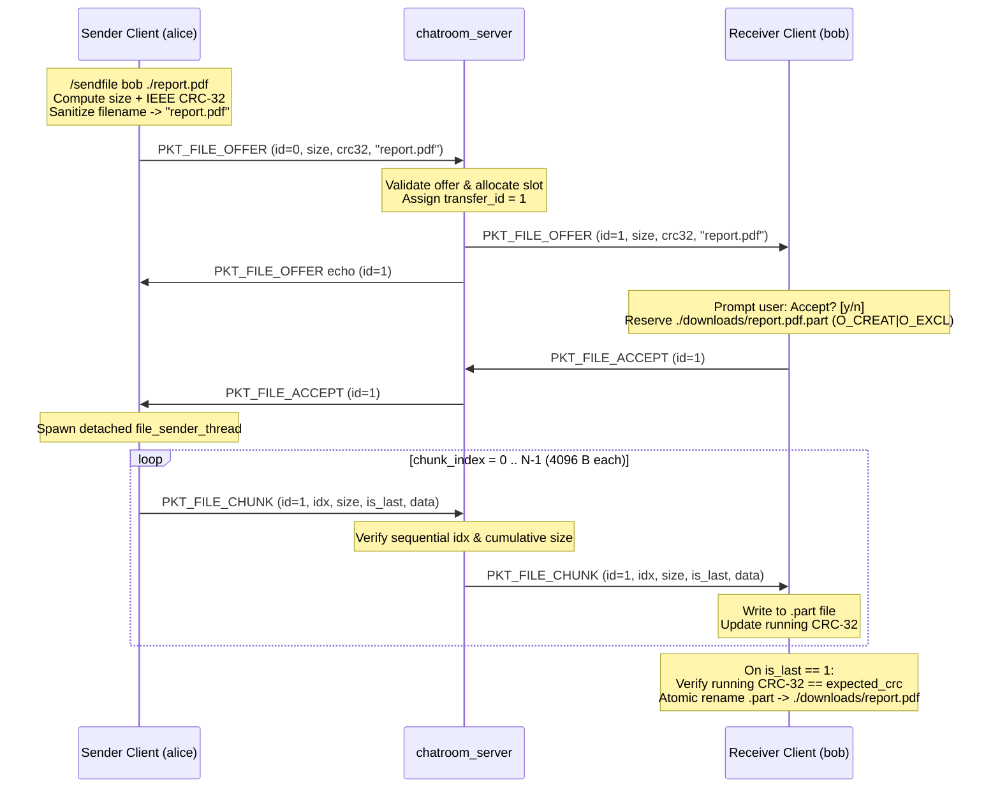

# Chatroom System & Wire Protocol Reference

This document provides the complete technical specification for the `chatroom/` subsystem, including the binary wire protocol, chunked file transfer state machine, audit logger format, client CLI commands, and server administrative console.

---

## 1. Wire Framing Specification (`protocol.h` / `protocol.c`)

TCP is a byte-stream protocol without native message boundaries: a single `send()` may be split across multiple TCP segments, or multiple `send()` calls may coalesce into one `recv()`. To guarantee message boundaries, every chatroom frame begins with a fixed-size **68-byte packed header** followed immediately by `payload_len` bytes of payload (`0..4160` bytes).

### Packet Header Layout (`packet_header_t`)

```text
 0                   1                   2                   3
 0 1 2 3 4 5 6 7 8 9 0 1 2 3 4 5 6 7 8 9 0 1 2 3 4 5 6 7 8 9 0 1
+-+-+-+-+-+-+-+-+-+-+-+-+-+-+-+-+-+-+-+-+-+-+-+-+-+-+-+-+-+-+-+-+
|          type (uint16)        |      payload_len (uint16)     |  Bytes 0..3   (Network Byte Order)
+-+-+-+-+-+-+-+-+-+-+-+-+-+-+-+-+-+-+-+-+-+-+-+-+-+-+-+-+-+-+-+-+
|                                                               |
|                        sender (char[32])                      |  Bytes 4..35  (NUL-padded ASCII)
|                                                               |
+-+-+-+-+-+-+-+-+-+-+-+-+-+-+-+-+-+-+-+-+-+-+-+-+-+-+-+-+-+-+-+-+
|                                                               |
|                  recipient_or_group (char[32])                |  Bytes 36..67 (NUL-padded ASCII)
|                                                               |
+-+-+-+-+-+-+-+-+-+-+-+-+-+-+-+-+-+-+-+-+-+-+-+-+-+-+-+-+-+-+-+-+
|                                                               |
|               payload (0 .. 4160 bytes, variable)             |  Bytes 68..68+payload_len-1
|                                                               |
+-+-+-+-+-+-+-+-+-+-+-+-+-+-+-+-+-+-+-+-+-+-+-+-+-+-+-+-+-+-+-+-+
```

```c
#define PROTO_NAME_LEN 32
#define PROTO_MAX_PAYLOAD 4160

typedef struct __attribute__((packed)) {
    uint16_t type;                              /* packet_type_t in big-endian (network) order */
    uint16_t payload_len;                       /* 0 .. PROTO_MAX_PAYLOAD (4160) in big-endian */
    char sender[PROTO_NAME_LEN];                /* NUL-terminated sender username */
    char recipient_or_group[PROTO_NAME_LEN];    /* Target username or group channel name */
} packet_header_t;
```

### Packet Types (`packet_type_t`)

| Enum Identifier | Code | Direction | `recipient_or_group` | Payload Format |
|---|---:|---|---|---|
| `PKT_HANDSHAKE` | `1` | Client $\rightarrow$ Server | `""` | Empty (`payload_len = 0`); username in `hdr.sender` |
| `PKT_MSG_PUBLIC` | `2` | Client $\leftrightarrow$ Server | `""` | UTF-8/ASCII text (`1..4160` bytes) |
| `PKT_MSG_PRIVATE` | `3` | Client $\leftrightarrow$ Server | Target `<username>` | UTF-8/ASCII text (`1..4160` bytes) |
| `PKT_MSG_GROUP` | `4` | Client $\leftrightarrow$ Server | `<group>` (without `#`) | UTF-8/ASCII text (`1..4160` bytes) |
| `PKT_CMD_USERS` | `5` | Client $\rightarrow$ Server | `""` | Empty (`payload_len = 0`) |
| `PKT_CMD_JOIN_GRP` | `6` | Client $\rightarrow$ Server | `<group>` | Empty (`payload_len = 0`) |
| `PKT_CMD_LEAVE_GRP` | `7` | Client $\rightarrow$ Server | `<group>` | Empty (`payload_len = 0`) |
| `PKT_DISCONNECT` | `8` | Client $\rightarrow$ Server | `""` | Empty (`payload_len = 0`) |
| `PKT_SERVER_INFO` | `9` | Server $\rightarrow$ Client | Client username or group | Informational notice text |
| `PKT_SERVER_ERROR` | `10` | Server $\rightarrow$ Client | Client username or `""` | Error diagnostic text |
| `PKT_FILE_OFFER` | `11` | Client $\leftrightarrow$ Server | Target `<username>` | 144-byte packed `file_offer_t` |
| `PKT_FILE_ACCEPT` | `12` | Client $\leftrightarrow$ Server | Peer `<username>` | 4-byte big-endian `transfer_id` |
| `PKT_FILE_REJECT` | `13` | Client $\leftrightarrow$ Server | Peer `<username>` | 4-byte big-endian `transfer_id` |
| `PKT_FILE_CHUNK` | `14` | Client $\leftrightarrow$ Server | Target `<username>` | 11-byte chunk header + `0..4096` data bytes |
| `PKT_FILE_ABORT` | `15` | Client $\leftrightarrow$ Server | Peer `<username>` | 4-byte `transfer_id` + optional reason string |

### Core Framing API (`protocol.h`)

| Function | Signature | Behavior & Return Value |
|---|---|---|
| `send_all` | `ssize_t send_all(int sockfd, const void *buf, size_t len)` | Loops over `send(..., MSG_NOSIGNAL)` until `len` bytes are written; retries on `EINTR`. Returns `len` or `-1` on error. |
| `recv_all` | `ssize_t recv_all(int sockfd, void *buf, size_t len)` | Loops over `recv()` until `len` bytes arrive; retries on `EINTR`. Returns `len`, `0` on clean EOF before byte 0, or `-1` on error/mid-frame EOF. |
| `packet_send` | `bool packet_send(int sockfd, packet_type_t type, const char *sender, const char *target, const void *payload, size_t payload_len)` | Validates `payload_len <= PROTO_MAX_PAYLOAD`, converts header fields via `htons`, and writes the entire frame in one `send_all()` call. |
| `packet_recv` | `int packet_recv(int sockfd, packet_header_t *hdr, char *payload)` | Reads 68-byte header, converts fields via `ntohs`, validates bounds (`type` in `1..15`, `payload_len <= 4160`), reads payload, and NUL-terminates `payload[payload_len]`. Returns `1` (ok), `0` (EOF), or `-1` (invalid/error). |
| `proto_valid_name` | `bool proto_valid_name(const char *name)` | Returns `true` iff `name` is `2..30` characters of `[A-Za-z0-9_.-]`. |
| `proto_parse_input` | `input_action_t proto_parse_input(const char *line, parsed_input_t *out)` | Parses one line of user terminal input into an `input_action_t` and populates `parsed_input_t`. |

---

## 2. Chunked Binary File Transfer (`fileshare.h` / `fileshare.c`)

Files up to **50 MB** (`FS_MAX_FILE_SIZE`) are transferred between clients in **4096-byte** chunks (`FS_CHUNK_SIZE`) relayed through the server, verified end-to-end with an **IEEE 802.3 CRC-32** checksum (`0xEDB88320` polynomial).

### End-to-End File Transfer Sequence



### Binary Payload Formats

#### 1. File Offer Payload (`file_offer_t` — 144 bytes packed)

| Offset | Field | Type | Endianness | Description |
|---:|---|---|---|---|
| `0..31` | `sender` | `char[32]` | ASCII | Offerer username |
| `32..63` | `recipient` | `char[32]` | ASCII | Target username |
| `64..127` | `filename` | `char[64]` | ASCII | Sanitized basename (`[A-Za-z0-9._-]`, no leading `.`) |
| `128..135` | `file_size` | `uint64_t` | Big-Endian (`hton64`) | Total file size in bytes (`0 .. 52,428,800`) |
| `136..139` | `checksum_crc32` | `uint32_t` | Big-Endian (`htonl`) | Full-file IEEE CRC-32 checksum |
| `140..143` | `transfer_id` | `uint32_t` | Big-Endian (`htonl`) | `0` from sender; assigned `>= 1` by server |

#### 2. File Chunk Payload (`FS_CHUNK_HEADER_LEN = 11` bytes + `chunk_size` bytes)

| Offset | Field | Type | Endianness | Description |
|---:|---|---|---|---|
| `0..3` | `transfer_id` | `uint32_t` | Big-Endian | Server-assigned transfer ID |
| `4..7` | `chunk_index` | `uint32_t` | Big-Endian | Sequential 0-based chunk counter (`0, 1, 2, ...`) |
| `8..9` | `chunk_size` | `uint16_t` | Big-Endian | Payload data bytes in this chunk (`0 .. 4096`) |
| `10` | `is_last_chunk` | `uint8_t` | Byte | `1` on final chunk (`received + chunk_size == file_size`), `0` otherwise |
| `11..11+chunk_size-1` | `data` | `uint8_t[]` | Raw bytes | Raw file bytes |

#### 3. Control Payload (`PKT_FILE_ACCEPT`, `PKT_FILE_REJECT`, `PKT_FILE_ABORT`)

- Bytes `0..3`: 4-byte big-endian `transfer_id`.
- Bytes `4..N`: Optional UTF-8 reason string (used by `PKT_FILE_ABORT`, e.g., `"peer disconnected"`, `"checksum mismatch, file discarded"`).

### Receiver Verification & Failure Handling (`fs_chunk_status_t`)

`fs_receiver_chunk()` enforces strict invariants on every incoming chunk:

| Status Code | Trigger Condition | Action Taken |
|---|---|---|
| `FS_CHUNK_MORE` | Chunk valid and written; `is_last == false` | Updates running CRC-32 and `next_index++` |
| `FS_CHUNK_DONE` | Final chunk written, `fflush`/`fclose` succeed, `crc == expected_crc` | Atomically renames `<path>.part` $\rightarrow$ `<path>` |
| `FS_ERR_ORDER` | Wrong `transfer_id` or `chunk_index != next_index` | Rejects chunk |
| `FS_ERR_SIZE` | `chunk_size > 4096`, cumulative bytes exceed `expected_size`, or premature/missing `is_last` | Closes and `unlink()`s `.part` file; sends `PKT_FILE_ABORT` |
| `FS_ERR_CRC` | Final chunk received, but computed CRC-32 $\ne$ `expected_crc` | Deletes corrupted `.part` file; sends `PKT_FILE_ABORT` |
| `FS_ERR_IO` | Disk write, flush, or `rename()` failure | Deletes `.part` file; sends `PKT_FILE_ABORT` |

---

## 3. Audit Logger (`logger.h` / `logger.c`)

The server maintains a persistent, append-only audit trail (`server.log` by default, or custom path via `argv[3]`).

### Log Entry Format

```text
[YYYY-MM-DDTHH:MM:SSZ] [LEVEL] [CAT]  message
```

Example entries:

```text
[2026-11-12T22:00:01Z] [INFO] [SERV] Server started on 127.0.0.1:8888 (log: server.log)
[2026-11-12T22:00:05Z] [INFO] [CONN] Client 'alice' connected from 127.0.0.1:51234
[2026-11-12T22:00:08Z] [WARN] [AUTH] Duplicate username rejected: 'alice'
[2026-11-12T22:00:12Z] [INFO] [MSG]  'alice' -> ALL: "Hello world"
[2026-11-12T22:00:15Z] [INFO] [PRIV] 'alice' -> 'bob': "Private note"
[2026-11-12T22:00:19Z] [INFO] [GRP]  'alice' joined #eng
[2026-11-12T22:00:22Z] [INFO] [FILE] 'alice' offered 'data.bin' (8192 bytes) to 'bob' [id 1]
[2026-11-12T22:00:25Z] [INFO] [ADMIN] Broadcast: "Server restarting soon"
[2026-11-12T22:00:30Z] [INFO] [SERV] Server stopped cleanly
```

### Audit Categories

| Category | Level(s) | Events Logged |
|---|---|---|
| `SERV` | `INFO` | Server startup and clean shutdown |
| `CONN` / `DISC` | `INFO` | Client connection (with IP and port) and disconnection |
| `AUTH` | `WARN` | Rejected invalid or duplicate usernames during handshake |
| `MSG` | `INFO` | Public broadcast messages |
| `PRIV` | `INFO` | 1-on-1 private messages |
| `GRP` | `INFO` | Group channel join, leave, and group messages |
| `FILE` | `INFO`, `WARN` | File offers, accepts, rejects, completions, and aborts |
| `ADMIN` | `INFO`, `WARN` | Admin broadcasts, user kicks, and console shutdown requests |
| `PROTO` | `WARN` | Unsupported or malformed packet types |

---

## 4. Client CLI Reference (`chatroom_client`)

**Invocation**: `./build/bin/chatroom_client <IP> <Port>`

| Command | Wire Packet | Description |
|---|---|---|
| `<text>` | `PKT_MSG_PUBLIC` | Broadcast `<text>` to all connected users |
| `/msg <user> <text>` | `PKT_MSG_PRIVATE` | Send a private message to `<user>` |
| `/group <name>` | `PKT_CMD_JOIN_GRP` | Join group channel `#<name>` (`[A-Za-z0-9_-]{1,30}`, max 8 groups/client) |
| `#<name> <text>` | `PKT_MSG_GROUP` | Send `<text>` to all members of group `#<name>` |
| `/leave <name>` | `PKT_CMD_LEAVE_GRP` | Leave group channel `#<name>` |
| `/users` | `PKT_CMD_USERS` | Request the list of currently connected usernames |
| `/sendfile <user> <path>` | `PKT_FILE_OFFER` | Offer regular file at `<path>` (max 50 MB) to `<user>` |
| `y` / `n` (or `yes` / `no`) | `PKT_FILE_ACCEPT` / `REJECT` | Quick-accept or reject the most recent pending file offer |
| `/fileaccept <id>` | `PKT_FILE_ACCEPT` | Explicitly accept pending file offer `<id>` |
| `/filereject <id>` | `PKT_FILE_REJECT` | Explicitly reject pending file offer `<id>` |
| `/help` | *(local)* | Print the client command summary |
| `/exit` (or `Ctrl+C`) | `PKT_DISCONNECT` | Cleanly disconnect from the server |

---

## 5. Server Administrative Console Reference (`chatroom_server`)

**Invocation**: `./build/bin/chatroom_server <IP> <Port> [logfile]`

| Console Command | Description |
|---|---|
| `help` | Display available administrative commands |
| `users` | Print formatted table of active clients (`UID`, `USERNAME`, `IP`, `PORT`, `DURATION HH:MM:SS`) |
| `stats` | Display server uptime, active/peak clients, total connections, message counts (broadcast/private/group), `Bytes TX / RX`, and live monitor state |
| `monitor [on\|off]` | Query or toggle live traffic echoing of public, private, and group messages to server `stdout` |
| `kick <username>` | Send an admin kick error to `<username>`, close their socket (`SHUT_RDWR`), broadcast departure, and log under `[ADMIN]` |
| `broadcast <msg>` | Broadcast `[ADMIN] <msg>` (`PKT_SERVER_INFO`) to all connected clients |
| `shutdown` / `quit` | Broadcast `SERVER_SHUTDOWN`, close all client sockets, join all worker threads, flush `server.log`, and exit `0` |

### Server Resource Limits (`server.c`)

| Constant | Value | Meaning |
|---|---:|---|
| `MAX_CLIENTS` | `50` | Maximum concurrent connected clients |
| `MAX_GROUPS_PER_CLIENT` | `8` | Maximum group channels a single client can join simultaneously |
| `MAX_TRANSFERS` | `32` | Maximum concurrent file transfers tracked by the server relay |
| `MAX_PENDING` (`client.c`) | `8` | Maximum concurrent incoming/outgoing/receiving file transfers per client |
