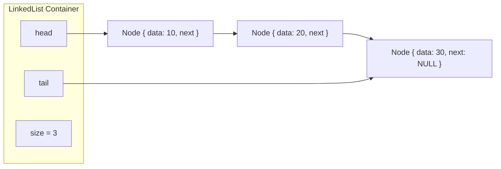
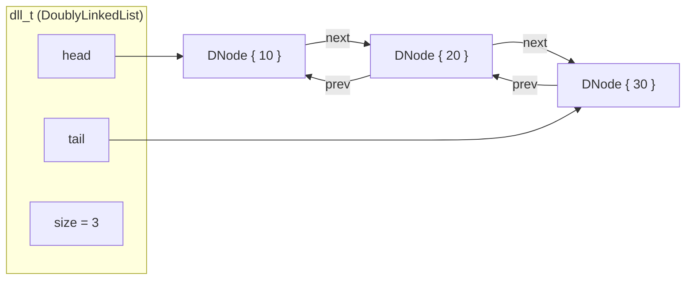
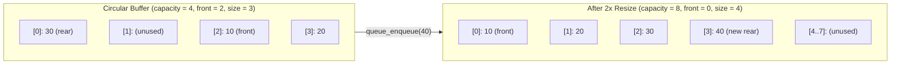

# Data Structures API Reference

This document provides the complete C/C++ API reference, memory layout diagrams, invariants, and asymptotic complexity analysis for all seven standalone libraries under [`structures/`](../structures/).

---

## 1. Asymptotic Complexity Summary

| Data Structure | CMake Target | Header | Insert / Push | Delete / Pop | Search / Access | Space |
|---|---|---|---|---|---|---|
| **Singly Linked List** (`LinkedList`) | `singly_linked_list` | [`node.h`](../structures/linked-lists/singly-linked-list/node.h) | Prepend/Append: $O(1)$<br/>At index: $O(N)$ | Pop front: $O(1)$<br/>Pop back / index / val: $O(N)$ | By index / value: $O(N)$ | $O(N)$ |
| **Doubly Linked List** (`dll_t`) | `doubly_linked_list` | [`dll.h`](../structures/linked-lists/doubly-linked-list/dll.h) | Front / Back / Before / After node: $O(1)$ | Front / Back / Remove node: $O(1)$ | Forward / Reverse find: $O(N)$ | $O(N)$ |
| **Dynamic Array** (`Vector`) | `vector` | [`vector.h`](../structures/vector/vector.h) | `push_back`: $O(1)$ amortized<br/>`insert`: $O(N)$ | `pop_back`: $O(1)$<br/>`erase`: $O(N)$ | `get` / `set`: $O(1)$ | $O(N)$ |
| **LIFO Stack** (`Stack`) | `stack` | [`stack.h`](../structures/stack/stack.h) | `stack_push`: $O(1)$ amortized | `stack_pop`: $O(1)$ | `stack_peek`: $O(1)$ | $O(N)$ |
| **Circular FIFO Queue** (`Queue`) | `queue` | [`queue.h`](../structures/queue/queue.h) | `queue_enqueue`: $O(1)$ amortized | `queue_dequeue`: $O(1)$ | `queue_peek`: $O(1)$ | $O(N)$ |
| **Binary Search Tree** (`BST`) | `bst` | [`bst.h`](../structures/binary_search_tree/bst.h) | $O(h)$ ($O(\log N)$ avg, $O(N)$ worst) | $O(h)$ (3-case successor) | $O(h)$ ($O(\log N)$ avg) | $O(N)$ |
| **Hash Table** (`HashTable`) | `hash_table` | [`hash_table.h`](../structures/hash_table/hash_table.h) | $O(1)$ avg (rehash at $\alpha \ge 0.75$) | $O(1)$ avg | $O(1)$ avg | $O(N + B)$ |

---

## 2. Singly Linked List (`singly_linked_list`)

- **Header**: [`structures/linked-lists/singly-linked-list/node.h`](../structures/linked-lists/singly-linked-list/node.h) (includes `extern "C"` C++ guard)
- **Sources**: [`linked_list.c`](../structures/linked-lists/singly-linked-list/linked_list.c), [`list_container.c`](../structures/linked-lists/singly-linked-list/list_container.c)
- **CMake Target**: `singly_linked_list`

### Memory Layout



### Types

```c
typedef struct Node {
    int data;
    struct Node *next;
} node, Node;

typedef struct LinkedList {
    Node *head;
    Node *tail;
    size_t size;
} LinkedList;
```

### `LinkedList` Container API

| Function | Signature | Complexity | Description |
|---|---|---|---|
| `list_create` | `LinkedList *list_create(void)` | $O(1)$ | Allocates and zero-initializes an empty `LinkedList`. Returns `NULL` on OOM. |
| `list_destroy` | `void list_destroy(LinkedList *list)` | $O(N)$ | Frees all nodes and the `LinkedList` container. Safe on `NULL`. |
| `list_clear` | `void list_clear(LinkedList *list)` | $O(N)$ | Frees all nodes and resets `head = tail = NULL`, `size = 0`. |
| `list_prepend` | `bool list_prepend(LinkedList *list, int data)` | $O(1)$ | Inserts `data` at `head`. Updates `tail` if list was empty. |
| `list_append` | `bool list_append(LinkedList *list, int data)` | $O(1)$ | Appends `data` at `tail` in $O(1)$ using the tracked `tail` pointer. |
| `list_insert_at` | `bool list_insert_at(LinkedList *list, size_t index, int data)` | $O(N)$ | Inserts at `0 <= index <= size`. Returns `false` if `index > size` or `list == NULL`. |
| `list_pop_front` | `bool list_pop_front(LinkedList *list, int *out_data)` | $O(1)$ | Removes head node; writes value to `*out_data` if non-`NULL`. |
| `list_pop_back` | `bool list_pop_back(LinkedList *list, int *out_data)` | $O(N)$ | Removes tail node; traverses to penultimate node to update `tail`. |
| `list_remove_at` | `bool list_remove_at(LinkedList *list, size_t index, int *out_data)` | $O(N)$ | Removes node at `0 <= index < size`. |
| `list_remove_value` | `bool list_remove_value(LinkedList *list, int data)` | $O(N)$ | Removes first node matching `data`. Returns `false` if not found. |
| `list_get_at` | `bool list_get_at(const LinkedList *list, size_t index, int *out_data)` | $O(N)$ | Reads element at `index` into `*out_data` (must be non-`NULL`). |
| `list_index_of` | `ssize_t list_index_of(const LinkedList *list, int data)` | $O(N)$ | Returns 0-based index of first match, or `-1` if not found. |
| `list_contains` | `bool list_contains(const LinkedList *list, int data)` | $O(N)$ | Returns `true` if `data` is in `list`. |
| `list_size` | `size_t list_size(const LinkedList *list)` | $O(1)$ | Returns element count (`0` if `list == NULL`). |
| `list_is_empty` | `bool list_is_empty(const LinkedList *list)` | $O(1)$ | Returns `true` if `list == NULL` or `size == 0`. |
| `list_reverse` | `void list_reverse(LinkedList *list)` | $O(N)$ | Reverses list in-place using 3-pointer iteration (`prev`, `cur`, `next`) in $O(1)$ auxiliary space. |
| `list_sort` | `void list_sort(LinkedList *list)` | $O(N \log N)$ | Sorts ascending via top-down recursive **MergeSort** (tortoise-and-hare split, stable merge) and repairs `tail`. |

### Raw `Node` Manipulation API

For direct node-pointer manipulation without a `LinkedList` wrapper:

- `bool list_append_node(node **head, int data)`: Appends a newly allocated node to `*head` in $O(N)$.
- `bool list_min(const node *head, int *min_out)` / `bool list_max(const node *head, int *max_out)`: Computes extremum in $O(N)$; returns `false` on empty list or `NULL` output pointer.
- `void list_free(node **head)`: Frees chain and sets `*head = NULL`.
- `void print_list(const node *head)`: Prints `[data] -> next_ptr` chain to `stdout`.

---

## 3. Doubly Linked List (`doubly_linked_list`)

- **Header**: [`structures/linked-lists/doubly-linked-list/dll.h`](../structures/linked-lists/doubly-linked-list/dll.h) (includes `extern "C"` C++ guard)
- **Source**: [`dll.c`](../structures/linked-lists/doubly-linked-list/dll.c)
- **CMake Target**: `doubly_linked_list`

### Memory Layout



### Types

```c
typedef struct dll_node {
    union {
        int value;
        int data;
    };
    struct dll_node *prev;
    struct dll_node *next;
} dll_node_t, DNode;

typedef struct dll {
    dll_node_t *head;
    dll_node_t *tail;
    size_t size;
} dll_t, DoublyLinkedList;
```

### API Reference

| Function | Signature | Complexity | Description |
|---|---|---|---|
| `dll_create` | `dll_t *dll_create(void)` | $O(1)$ | Allocates an empty doubly linked list. |
| `dll_destroy` | `void dll_destroy(dll_t *list)` | $O(N)$ | Frees all nodes and the list container. |
| `dll_clear` | `void dll_clear(dll_t *list)` | $O(N)$ | Frees all nodes; resets `head = tail = NULL` and `size = 0`. |
| `dll_push_front` | `bool dll_push_front(dll_t *list, int value)` | $O(1)$ | Prepends `value` before `head`. |
| `dll_push_back` | `bool dll_push_back(dll_t *list, int value)` | $O(1)$ | Appends `value` after `tail`. |
| `dll_pop_front` | `bool dll_pop_front(dll_t *list, int *out_value)` | $O(1)$ | Removes `head`; writes value to `*out_value` if non-`NULL`. |
| `dll_pop_back` | `bool dll_pop_back(dll_t *list, int *out_value)` | $O(1)$ | Removes `tail` in $O(1)$ via `tail->prev`. |
| `dll_find` | `dll_node_t *dll_find(const dll_t *list, int value)` | $O(N)$ | Forward search from `head`; returns matching node pointer or `NULL`. |
| `dll_find_reverse` | `dll_node_t *dll_find_reverse(const dll_t *list, int value)` | $O(N)$ | Reverse search from `tail`; returns first match from back or `NULL`. |
| `dll_insert_after` | `bool dll_insert_after(dll_t *list, dll_node_t *node, int value)` | $O(1)$ | Splices a new node immediately after `node` (updates `tail` if `node == tail`). |
| `dll_insert_before` | `bool dll_insert_before(dll_t *list, dll_node_t *node, int value)` | $O(1)$ | Splices a new node immediately before `node` (updates `head` if `node == head`). |
| `dll_remove_node` | `bool dll_remove_node(dll_t *list, dll_node_t *node)` | $O(1)$ | Unlinks and frees `node` in $O(1)$, updating `head`/`tail` pointers as needed. |
| `dll_size` / `dll_is_empty` | `size_t dll_size(const dll_t *list)` / `bool dll_is_empty(const dll_t *list)` | $O(1)$ | Queries current size and emptiness. |
| `dll_print_forward` / `backward` | `void dll_print_forward(const dll_t *list)` | $O(N)$ | Prints elements `Head -> Tail` or `Tail -> Head`. |

---

## 4. Dynamic Array (`vector`)

- **Header**: [`structures/vector/vector.h`](../structures/vector/vector.h) (includes `extern "C"` C++ guard)
- **Source**: [`vector.c`](../structures/vector/vector.c)
- **CMake Target**: `vector`

### Growth & Memory Invariants

- When `initial_capacity == 0`, `vector_create(0)` sets `data = NULL` and `capacity = 0` (lazy allocation).
- On the first push into a 0-capacity vector, capacity initializes to `VECTOR_DEFAULT_INITIAL_CAPACITY` (`4`).
- Whenever `size == capacity`, `vector_ensure_capacity()` doubles capacity ($2\times$ geometric progression) via `realloc`, guaranteeing $O(1)$ amortized insertion.
- Shifts on `vector_insert` and `vector_erase` use overlap-safe `memmove()`.

### API Reference

| Function | Signature | Complexity | Description |
|---|---|---|---|
| `vector_create` | `Vector *vector_create(size_t initial_capacity)` | $O(1)$ | Allocates a `Vector` with `initial_capacity` slots (`0` for lazy allocation). |
| `vector_destroy` | `void vector_destroy(Vector *vec)` | $O(1)$ | Frees `vec->data` and `vec`. |
| `vector_push_back` | `bool vector_push_back(Vector *vec, int value)` | $O(1)$ amort. | Appends `value`, doubling capacity if full. |
| `vector_pop_back` | `bool vector_pop_back(Vector *vec, int *out_value)` | $O(1)$ | Decrements `size` and optionally writes removed element to `*out_value`. |
| `vector_get` | `bool vector_get(const Vector *vec, size_t index, int *out_value)` | $O(1)$ | Bounds-checked read at `index < size`; `out_value` must be non-`NULL`. |
| `vector_set` | `bool vector_set(Vector *vec, size_t index, int value)` | $O(1)$ | Bounds-checked write at `index < size`. |
| `vector_insert` | `bool vector_insert(Vector *vec, size_t index, int value)` | $O(N)$ | Inserts at `index <= size`, shifting `[index .. size-1]` right via `memmove`. |
| `vector_erase` | `bool vector_erase(Vector *vec, size_t index)` | $O(N)$ | Removes at `index < size`, shifting `[index+1 .. size-1]` left via `memmove`. |
| `vector_clear` | `void vector_clear(Vector *vec)` | $O(1)$ | Sets `size = 0` while retaining allocated capacity. |
| `vector_shrink_to_fit` | `bool vector_shrink_to_fit(Vector *vec)` | $O(N)$ | Reallocates `data` to match `size` (or frees `data` if `size == 0`). |
| `vector_size` / `capacity` / `is_empty` | `size_t vector_size(const Vector *vec)` | $O(1)$ | Inspects `size`, `capacity`, and emptiness (`true` on `NULL`). |

---

## 5. LIFO Stack (`stack`)

- **Header**: [`structures/stack/stack.h`](../structures/stack/stack.h) (includes `extern "C"` C++ guard)
- **Source**: [`stack.c`](../structures/stack/stack.c)
- **CMake Target**: `stack`

### API Reference

| Function | Signature | Complexity | Description |
|---|---|---|---|
| `stack_create` | `Stack *stack_create(size_t initial_capacity)` | $O(1)$ | Creates stack with `initial_capacity` (uses default `4` if `0` is passed). |
| `stack_destroy` | `void stack_destroy(Stack *stack)` | $O(1)$ | Frees internal buffer and `Stack` struct. |
| `stack_push` | `bool stack_push(Stack *stack, int value)` | $O(1)$ amort. | Pushes `value` onto top of stack; doubles capacity when full. |
| `stack_pop` | `bool stack_pop(Stack *stack, int *out_value)` | $O(1)$ | Removes top element; writes to `*out_value` if non-`NULL`. Returns `false` if empty. |
| `stack_peek` | `bool stack_peek(const Stack *stack, int *out_value)` | $O(1)$ | Writes top element to `*out_value` (must be non-`NULL`) without removing it. |
| `stack_is_empty` / `size` / `capacity` | `size_t stack_size(const Stack *stack)` | $O(1)$ | Returns current state metrics. |

---

## 6. Circular Ring-Buffer FIFO Queue (`queue`)

- **Header**: [`structures/queue/queue.h`](../structures/queue/queue.h) (includes `extern "C"` C++ guard)
- **Source**: [`queue.c`](../structures/queue/queue.c)
- **CMake Target**: `queue`

### Ring-Buffer Wrap-Around & Resize Design



- **Enqueue index**: `rear = (front + size) % capacity`.
- **Dequeue index**: reads `data[front]` and advances `front = (front + 1) % capacity` in $O(1)$ with zero memory shifting.
- **Resize unrolling**: When `size == capacity`, `queue_enqueue` allocates a $2\times$ buffer and copies elements `i = 0 .. size - 1` from `(front + i) % capacity` to `new_data[i]`, resetting `front = 0`.

### API Reference

| Function | Signature | Complexity | Description |
|---|---|---|---|
| `queue_create` | `Queue *queue_create(size_t initial_capacity)` | $O(1)$ | Creates circular queue (defaults to capacity `4` when `initial_capacity == 0`). |
| `queue_destroy` | `void queue_destroy(Queue *queue)` | $O(1)$ | Frees circular buffer and `Queue` struct. |
| `queue_enqueue` | `bool queue_enqueue(Queue *queue, int value)` | $O(1)$ amort. | Inserts `value` at circular rear; unrolls and doubles capacity when full. |
| `queue_dequeue` | `bool queue_dequeue(Queue *queue, int *out_value)` | $O(1)$ | Removes front element and advances `front` modulo `capacity`. |
| `queue_peek` | `bool queue_peek(const Queue *queue, int *out_value)` | $O(1)$ | Reads `data[front]` into `*out_value` (must be non-`NULL`). |
| `queue_is_empty` / `size` / `capacity` | `size_t queue_size(const Queue *queue)` | $O(1)$ | Returns current queue state metrics. |

---

## 7. Binary Search Tree (`bst`)

- **Header**: [`structures/binary_search_tree/bst.h`](../structures/binary_search_tree/bst.h) (includes `extern "C"` C++ guard)
- **Source**: [`bst.c`](../structures/binary_search_tree/bst.c)
- **CMake Target**: `bst`

### 3-Case Deletion Algorithm (`bst_delete`)

`bst_delete` uses double-pointer indirection (`BSTNode **link`) to splice nodes without parent pointers:
1. **Leaf Node (`left == NULL && right == NULL`)**: `*link = NULL`.
2. **Single Child (`left == NULL` or `right == NULL`)**: `*link` is replaced directly by the non-`NULL` child.
3. **Two Children (`left != NULL && right != NULL`)**: Locates the **in-order successor** (leftmost node in `victim->right`), detaches it via `*succ_link = succ->right`, adopts `victim->left` and `victim->right`, and links `succ` into `*link`.

### API Reference

| Function | Signature | Complexity | Description |
|---|---|---|---|
| `bst_create` | `BST *bst_create(void)` | $O(1)$ | Allocates an empty `BST`. |
| `bst_destroy` | `void bst_destroy(BST *tree)` | $O(N)$ | Recursively frees all `BSTNode`s in post-order, then frees `tree`. |
| `bst_insert` | `bool bst_insert(BST *tree, int key, int value)` | $O(h)$ | Inserts `(key, value)` or updates `value` in-place if `key` already exists (`size` unchanged). |
| `bst_search` | `bool bst_search(const BST *tree, int key, int *out_value)` | $O(h)$ | Iterative search; writes value to `*out_value` (optional, may be `NULL`) if found. |
| `bst_delete` | `bool bst_delete(BST *tree, int key)` | $O(h)$ | Removes `key` using 3-case deletion. Returns `false` if `key` is absent. |
| `bst_inorder` | `void bst_inorder(const BST *tree, bst_visit_fn visit)` | $O(N)$ | Visits nodes in ascending key order (`Left -> Node -> Right`). |
| `bst_preorder` | `void bst_preorder(const BST *tree, bst_visit_fn visit)` | $O(N)$ | Visits nodes in `Node -> Left -> Right` order. |
| `bst_postorder` | `void bst_postorder(const BST *tree, bst_visit_fn visit)` | $O(N)$ | Visits nodes in `Left -> Right -> Node` order. |
| `bst_height` | `size_t bst_height(const BST *tree)` | $O(N)$ | Returns node count along longest root-to-leaf path (`0` for empty tree). |
| `bst_size` | `size_t bst_size(const BST *tree)` | $O(1)$ | Returns number of keys stored in `tree`. |

---

## 8. Separate-Chaining Hash Table (`hash_table`)

- **Header**: [`structures/hash_table/hash_table.h`](../structures/hash_table/hash_table.h) (includes `extern "C"` C++ guard)
- **Source**: [`hash_table.c`](../structures/hash_table/hash_table.c)
- **CMake Target**: `hash_table`

### Architecture & Rehashing Strategy

- **Hash Function (`ht_hash`)**: Implements Dan Bernstein's **DJB2** hash (`h = 5381; h = ((h << 5) + h) + c`). Exposed publicly so unit tests can deterministically construct colliding keys.
- **Key Ownership**: `ht_insert()` allocates a private copy of `key` (`malloc(strlen(key) + 1)`). Callers may freely modify or deallocate their input string after insertion.
- **Load Factor & Rehashing**: When `ht_load_factor(ht) >= HT_MAX_LOAD` (`0.75f`), `rehash()` allocates a $2\times$ bucket array and **relinks existing `Entry` nodes in-place** without reallocating keys or entries.

```mermaid
flowchart LR
    subgraph Buckets["HashTable->buckets (bucket_count = 8)"]
        B0["[0]: NULL"]
        B1["[1]"]
        B2["[2]: NULL"]
        B3["[3]"]
    end
    E1A["Entry { key: \"alice\", value: 10 }"]
    E1B["Entry { key: \"bob\", value: 20, next: NULL }"]
    E3A["Entry { key: \"charlie\", value: 30, next: NULL }"]

    B1 --> E1A --> E1B
    B3 --> E3A
```

### API Reference

| Function | Signature | Complexity | Description |
|---|---|---|---|
| `ht_create` | `HashTable *ht_create(size_t initial_buckets)` | $O(B)$ | Allocates table with `initial_buckets` (`0` selects `HT_DEFAULT_BUCKETS = 8`). |
| `ht_destroy` | `void ht_destroy(HashTable *ht)` | $O(N + B)$ | Frees all copied keys, `Entry` nodes, bucket array, and `HashTable`. |
| `ht_insert` | `bool ht_insert(HashTable *ht, const char *key, int value)` | $O(1)$ avg | Inserts `(key, value)` or updates `value` if `key` exists. Rehashes at $\alpha \ge 0.75$. |
| `ht_get` | `bool ht_get(const HashTable *ht, const char *key, int *out_value)` | $O(1)$ avg | Looks up `key`; writes value to `*out_value` (optional, may be `NULL`). |
| `ht_contains` | `bool ht_contains(const HashTable *ht, const char *key)` | $O(1)$ avg | Shorthand for `ht_get(ht, key, NULL)`. |
| `ht_remove` | `bool ht_remove(HashTable *ht, const char *key)` | $O(1)$ avg | Unlinks and frees the entry matching `key`. Returns `false` if not found. |
| `ht_size` / `bucket_count` / `load_factor` | `float ht_load_factor(const HashTable *ht)` | $O(1)$ | Returns `size`, `bucket_count`, or `(float)size / (float)bucket_count`. |
| `ht_hash` | `unsigned long ht_hash(const char *key)` | $O(\|key\|)$ | Computes the DJB2 hash of `key`. |
