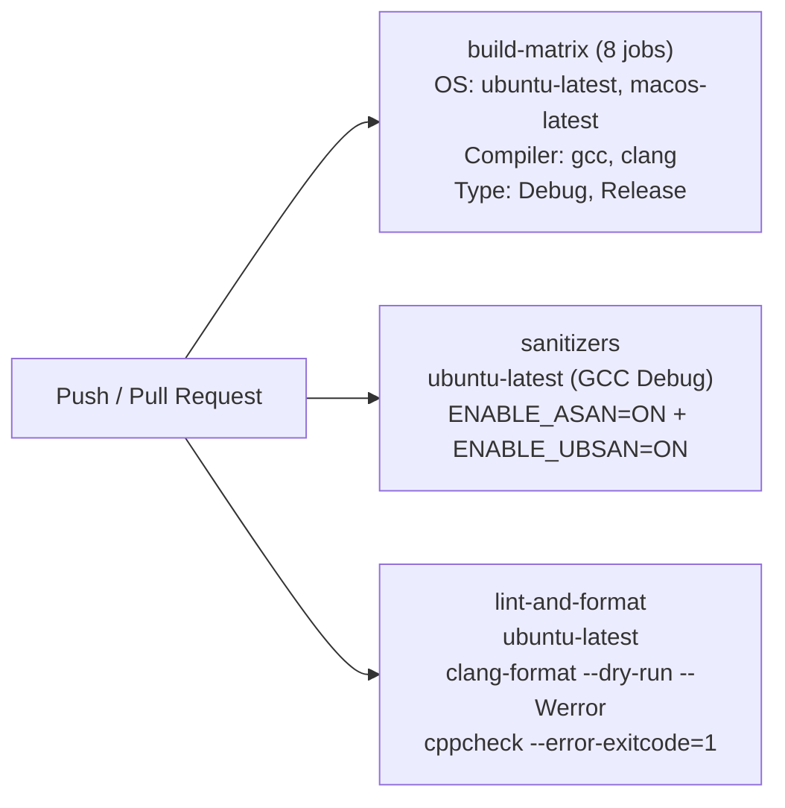

# Testing, Sanitizers & Quality Gates

`NetStruct` relies on automated tests, dynamic sanitizers, code formatting, and static analysis to verify correctness across Linux and macOS.

---

## 1. Full Verification Matrix (The Green Gate)

Every change must pass all four verification gates with zero warnings or errors before opening or merging a pull request:

```bash
# Gate 1: Release build (-O3 inlining + -Werror=format-truncation=)
cmake -B build -DCMAKE_BUILD_TYPE=Release -DENABLE_WERROR=ON
cmake --build build
ctest --test-dir build --output-on-failure

# Gate 2: Debug build with AddressSanitizer + UndefinedBehaviorSanitizer
cmake -B build -DCMAKE_BUILD_TYPE=Debug -DENABLE_WERROR=ON -DENABLE_ASAN=ON -DENABLE_UBSAN=ON
cmake --build build
ctest --test-dir build --output-on-failure

# Gate 3: Code formatting verification (clang-format)
find chatroom structures \( -name '*.c' -o -name '*.h' \) | xargs clang-format --dry-run --Werror

# Gate 4: Static analysis (cppcheck)
cppcheck --error-exitcode=1 --enable=warning,performance,portability \
  --inline-suppr --suppress=missingIncludeSystem \
  -I chatroom/includes chatroom/ structures/
```

---

## 2. CTest Suite Catalog (16 Test Targets)

### Chatroom Tests (`chatroom/tests/`)

| CTest Target | Source File | Type | What It Verifies |
|---|---|---|---|
| `test_logger` | [`test_logger.c`](../chatroom/tests/test_logger.c) | Unit | Append-only persistence across re-init, ISO-8601 UTC format, `\n`/`\r`/control-char escaping, multi-thread concurrent logging without line interleaving |
| `test_fileshare` | [`test_fileshare.c`](../chatroom/tests/test_fileshare.c) | Unit | IEEE CRC-32 test vectors, path traversal sanitization (`../../etc/passwd`), chunk encode/decode bounds, `.part` atomic reservation, collision numbering (`.1`, `.2`), corruption rollback |
| `test_protocol` | [`test_protocol.c`](../chatroom/tests/test_protocol.c) | Unit | `send_all`/`recv_all` across partial `socketpair()` writes, 68-byte header endianness, oversized/invalid packet rejection, `proto_valid_name`, CLI `proto_parse_input` coverage |
| `test_chat_features` | [`test_chat_features.c`](../chatroom/tests/test_chat_features.c) | Integration | Multi-client handshake, duplicate/invalid username rejection, public broadcast, `/msg` private routing, `/group` join/leave/fanout, `/users` list |
| `test_chat_logging` | [`test_chat_logging.c`](../chatroom/tests/test_chat_logging.c) | Integration | End-to-end verification that `chatroom_server` records `SERV`, `CONN`, `AUTH`, `MSG`, `PRIV`, `GRP`, and `DISC` audit events to disk |
| `test_file_transfer` | [`test_file_transfer.c`](../chatroom/tests/test_file_transfer.c) | Integration | Full server-relayed file offer, accept, reject, multi-chunk binary transfer, CRC-32 verification, tampered-chunk abort, and peer-disconnect cleanup |
| `test_admin_console` | [`test_admin_console.c`](../chatroom/tests/test_admin_console.c) | Integration | Piping `help`, `users`, `stats`, `monitor on/off`, `broadcast`, `kick`, and `shutdown` to server `stdin` via `fork()`/`pipe()` |
| `test_concurrency` | [`test_concurrency.c`](../chatroom/tests/test_concurrency.c) | Stress | Rapid connect/disconnect churn, simultaneous multi-thread broadcast storms, and clean `SIGTERM` teardown without deadlocks or socket leaks |

### Data Structure Tests (`structures/*/tests/`)

| CTest Target | Source File | What It Verifies |
|---|---|---|
| `test_singly_linked_list` | [`test_linked_list.c`](../structures/linked-lists/singly-linked-list/tests/test_linked_list.c) | Raw `node` helpers (`min`, `max`, `append`, `free`), `LinkedList` CRUD, $O(1)$ ends, `list_reverse`, `list_sort` (MergeSort on empty, single, sorted, reverse, duplicates), 10,000-element stress test |
| `singly_linked_list_demo` | [`demo.c`](../structures/linked-lists/singly-linked-list/demo.c) | Smoke test of the demo executable |
| `test_dll` | [`test_dll.c`](../structures/linked-lists/doubly-linked-list/tests/test_dll.c) | `dll_push_front`/`back`, `dll_pop_front`/`back`, `dll_find`/`dll_find_reverse`, `dll_insert_before`/`after` at head/middle/tail, `dll_remove_node` $O(1)$ splicing, 10,000-node stress test |
| `test_vector` | [`test_vector.c`](../structures/vector/tests/test_vector.c) | Lazy 0-capacity allocation, $2\times$ geometric growth, `get`/`set` bounds checks, `insert`/`erase` shifting, `shrink_to_fit`, `SIZE_MAX` overflow guards |
| `test_stack` | [`test_stack.c`](../structures/stack/tests/test_stack.c) | LIFO ordering, `stack_push`/`pop`/`peek`, geometric expansion, empty/NULL edge cases, 10,000-element stress test |
| `test_queue` | [`test_queue.c`](../structures/queue/tests/test_queue.c) | FIFO ordering, circular ring-buffer wrap-around (`front` advancing past end of array), $2\times$ resize unrolling while wrapped, 10,000-element stress test |
| `test_bst` | [`test_bst.c`](../structures/binary_search_tree/tests/test_bst.c) | Insert, duplicate key value update, search, 3-case deletion (leaf, 1-child, 2-child root & internal nodes), in/pre/post-order traversals, `bst_height` |
| `test_hash_table` | [`test_hash_table.c`](../structures/hash_table/tests/test_hash_table.c) | DJB2 hashing, key deep-copy ownership, collision chain resolution, automatic $2\times$ rehashing at load factor $\ge 0.75$, `ht_remove` from chain head/middle/tail |

---

## 3. Multi-Process Integration Test Harness (`chatroom/tests/test_util.h`)

Integration tests spawn a real `chatroom_server` child process and communicate with it over loopback TCP sockets (`127.0.0.1`):

- **Collision-Free Ports (`tc_port(slot)`)**: Computes `20000 + ((getpid() + slot * 997) % 20000)` so parallel `ctest -j` jobs never collide on the same TCP port.
- **Daemonized `stdin` (`tc_start_server_log`)**: Redirects child `STDIN_FILENO` to `/dev/null` via `dup2()` before `execl()` (unless the test explicitly pipes admin console commands) and polls `tc_connect()` for up to 5 seconds until the server is accepting connections.
- **Deterministic Teardown (`tc_stop_server`)**: Sends `SIGTERM` and `waitpid()`s for the server process, asserting `WIFEXITED(status) && WEXITSTATUS(status) == 0` so sanitizer leak checks in the child process are validated.

---

## 4. Coding & Cppcheck Standards for Tests

When adding or updating tests, follow these rules to keep `cppcheck` and `Release` builds clean:

1. **No Side Effects Inside `assert(...)` (`[assertWithSideEffect]`)**:
   Never call functions with side effects (`fwrite`, `fread`, `sscanf`, `packet_send`, `list_append`) directly inside `assert(...)`. Assign the result to a variable first:
   ```c
   /* Good */
   bool ok = list_append(list, 42);
   assert(ok);
   ```
2. **Always Check Allocations (`[nullPointerOutOfMemory]`)**:
   Assert that `malloc`/`calloc`/`*_create()` return non-`NULL` before dereferencing in tests.

---

## 5. Continuous Integration Pipeline (`.github/workflows/ci.yml`)

GitHub Actions runs three jobs on every push and pull request to `main`:


